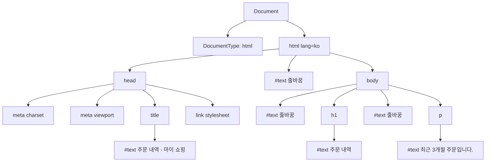

# Document 구조

> 📍 **커리큘럼 위치**: Track B · 1–3주 · Web Platform → HTML Parsing / Document 구조 / Semantic HTML (2/3)
>
> [HTML Parsing](html-parsing.md)에서 HTML 텍스트가 DOM이 되는 과정을 봤다. 이 페이지는 그 결과물인 **문서(Document)가 어떤 모양이고, 어떤 규칙으로 구성되는가**를 다룬다. 각 요소에 담기는 의미는 [Semantic HTML](semantic-html.md)에서 이어진다.

- [1. 학습 목표](#1-학습-목표)
- [2. 이 주제를 왜 배우는가](#2-이-주제를-왜-배우는가)
- [3. 핵심 개념과 용어](#3-핵심-개념과-용어)
- [4. 관련 계층과 역할 구분](#4-관련-계층과-역할-구분)
- [5. 내부 구조: 문서는 어떻게 생겼는가](#5-내부-구조-문서는-어떻게-생겼는가)
- [6. 코드 예제와 DOM·화면·상태 변화 해설](#6-코드-예제와-dom화면상태-변화-해설)
- [7. 흔한 오해·예외·주의점](#7-흔한-오해예외주의점)
- [8. 실무 적용, 접근성, 성능, 디버깅 관점](#8-실무-적용-접근성-성능-디버깅-관점)
- [9. 미리보기 개념 정리](#9-미리보기-개념-정리)
- [10. 핵심 정리](#10-핵심-정리)
- [11. 이해도 확인 질문](#11-이해도-확인-질문)

## 1. 학습 목표

- `Document`, `DocumentType`, `html`, `head`, `body`가 각각 무엇을 책임지는지 설명할 수 있다.
- DOM의 노드 종류와 부모·자식·형제 관계를 설명하고, `childNodes`와 `children`의 차이를 예측할 수 있다.
- `<!doctype html>`이 렌더링 모드를 결정하는 원리와 확인 방법(`document.compatMode`)을 설명할 수 있다.
- `head`에 들어가는 핵심 메타데이터(`charset`, `viewport`, `title`)와 `html`의 `lang`이 기능·접근성에 미치는 영향을 설명할 수 있다.
- **콘텐츠 모델**을 근거로 "이 요소 안에 저 요소를 넣어도 되는가"를 판단할 수 있다.
- 같은 문서의 네 가지 표현(소스, DOM, 렌더 트리, 접근성 트리)을 구분할 수 있다.

<details>
<summary>이 페이지에서 참고한 1차 출처</summary>

- [WHATWG DOM Standard](https://dom.spec.whatwg.org/)
- [WHATWG HTML Standard — 13.2 Parsing HTML documents](https://html.spec.whatwg.org/multipage/parsing.html)
- [MDN — Document Object Model (DOM) 소개](https://developer.mozilla.org/en-US/docs/Web/API/Document_Object_Model/Introduction)
- [MDN — Quirks mode and standards mode](https://developer.mozilla.org/en-US/docs/Web/HTML/Guides/Quirks_mode_and_standards_mode)
- [MDN — Content categories](https://developer.mozilla.org/en-US/docs/Web/HTML/Guides/Content_categories)
- [React 공식 문서 — ](https://react.dev/reference/react-dom/components/title)[`<title>`](https://react.dev/reference/react-dom/components/title)
- [W3C Nu HTML Checker](https://validator.w3.org/nu/)

</details>

---

## 2. 이 주제를 왜 배우는가

`document.querySelector`, CSS 선택자, React의 `createRoot(document.getElementById('root'))`, 스크린 리더의 문서 탐색은 모두 **같은 문서 트리**를 기준으로 동작한다. 이 트리의 모양을 정확히 모르면 다음과 같은 문제를 "이유를 모른 채" 겪게 된다.

- `element.firstChild`가 요소가 아니라 줄바꿈 텍스트를 반환한다.
- `head`의 스크립트에서 `document.body`가 `null`이라 오류가 난다.
- 첫 줄의 `<!doctype html>` 하나가 빠져서 특정 페이지의 레이아웃만 미묘하게 다르다.
- `lang`이 없거나 잘못되어 스크린 리더가 한국어를 영어 발음으로 읽는다.
- `viewport` 메타 태그가 없어 모바일에서 글자가 아주 작게 보인다.
- `<a>` 안에 `<button>`을 넣은 카드 컴포넌트가 키보드·스크린 리더에서 이상하게 동작한다.

문서 구조는 "HTML 기본 템플릿"으로 외우는 대상이 아니라, **브라우저·JS·CSS·보조 기술이 공유하는 데이터 구조의 규칙**이다.

## 3. 핵심 개념과 용어

| 용어 | 정의 |
| --- | --- |
| **문서(Document)** | DOM 트리의 최상위 노드. JavaScript의 전역 `document`가 이것이다. [MDN](https://developer.mozilla.org/en-US/docs/Web/API/Document_Object_Model/Introduction)은 `document`를 문서의 루트, `window`를 브라우저(창)에 가까운 것으로 설명한다 |
| **노드(Node)** | DOM 트리를 이루는 모든 객체의 공통 단위. 요소, 텍스트, 주석, 문서 자체도 모두 노드다 |
| **요소(Element)** | 태그로 표현되는 노드(`<p>`, `<div>` 등). 노드의 한 종류일 뿐, 모든 노드가 요소는 아니다 |
| **텍스트 노드(Text)** | 글자 내용을 담는 노드. 태그 사이의 줄바꿈·공백도 텍스트 노드가 될 수 있다 |
| **DocumentType** | `<!doctype html>`이 만든 노드. 문서 유형과 렌더링 모드 결정에 쓰인다 |
| **문서 요소(document element)** | 문서의 최상위 요소. HTML 문서에서는 `html` 요소이며 `document.documentElement`로 접근한다 |
| **메타데이터(Metadata)** | 내용이 아니라 "문서에 대한 정보". 인코딩, 제목, 뷰포트 설정, 스타일시트 연결 등 |
| **콘텐츠 카테고리 / 콘텐츠 모델** | 요소를 성격별로 묶은 분류(카테고리)와, 각 요소가 **자식으로 무엇을 가질 수 있는지**에 대한 규칙(모델) |
| **렌더링 모드** | 브라우저가 최신 표준대로 그릴지, 옛 브라우저 동작을 흉내 낼지 정하는 모드(no-quirks, limited-quirks, quirks) |

## 4. 관련 계층과 역할 구분

"문서"라는 말은 여러 계층에서 다른 뜻으로 쓰인다. 같은 문서가 계층마다 다른 형태로 존재한다.

| 표현 | 누가 만들고 누가 쓰나 | 특징 |
| --- | --- | --- |
| **HTML 소스** | 개발자·서버가 만든 텍스트 | 태그 생략, 들여쓰기, 오타가 그대로 있다 |
| **DOM 트리** | HTML 파서가 만들고, JS·CSS·React가 쓴다 | 노드의 종류와 관계는 [DOM 표준](https://dom.spec.whatwg.org/)이, 각 HTML 요소의 의미와 규칙은 HTML 표준이 정한다 |
| **렌더 트리** \[미리보기\] | DOM + CSSOM으로 브라우저가 만든다 | 화면에 그릴 것만 담는다. `head`나 `display: none` 요소는 빠진다 |
| **접근성 트리** \[미리보기\] | DOM에서 브라우저가 만들어 보조 기술에 전달한다 | 각 노드의 역할·이름·상태를 담는다. [Semantic HTML](semantic-html.md)에서 자세히 다룬다 |

\[미리보기: 렌더 트리\]

브라우저는 DOM과 CSSOM을 결합해 실제로 화면에 그릴 노드만 모은 구조를 만들고, 그 구조로 레이아웃과 페인트를 수행한다. 이 과정은 4–6주 Browser Internals에서 자세히 다룬다.

역할 구분을 한 번 더 정리하면 다음과 같다.

- **HTML**: 문서의 골격과 각 부분의 의미를 선언한다.
- **DOM**: 그 골격을 객체 트리로 보관하고 표준 API(`parentNode`, `childNodes` 등)를 제공한다.
- **JavaScript**: `document`를 통해 DOM을 읽고 바꾼다.
- **CSS**: DOM 노드에 선택자로 매칭되어 모양을 정한다. 트리 구조(부모·형제 관계)가 선택자 결과를 결정한다.
- **React**: 보통 `body` 안의 한 요소(예: `#root`)를 맡아 **그 아래 서브트리만** 관리한다. `html`, `head`, `body` 자체는 대개 `index.html`이 만든다.

## 5. 내부 구조: 문서는 어떻게 생겼는가

### 5.1 문서의 최소 골격

```html
<!doctype html>
<html lang="ko">
  <head>
    <meta charset="utf-8">
    <meta name="viewport" content="width=device-width, initial-scale=1">
    <title>주문 내역 - 마이 쇼핑</title>
    <link rel="stylesheet" href="/styles.css">
  </head>
  <body>
    <h1>주문 내역</h1>
    <p>최근 3개월 주문입니다.</p>
  </body>
</html>
```

| 줄 | 역할 | 빠지면 생기는 일 |
| --- | --- | --- |
| `<!doctype html>` | 문서를 **no-quirks(표준) 모드**로 처리하게 한다 | quirks 모드가 되어 일부 CSS 동작이 옛 방식으로 바뀐다 |
| `<html lang="ko">` | 문서 요소. `lang`은 문서의 주 언어를 선언한다 | 스크린 리더 발음, 번역 제안, 언어별 글꼴·줄바꿈 처리가 틀릴 수 있다 |
| `<meta charset="utf-8">` | 바이트를 글자로 읽는 인코딩을 선언한다 | 서버 헤더가 없으면 한글이 깨질 수 있다 |
| `<meta name="viewport" ...>` | 모바일 브라우저에 "화면 폭을 기기 폭에 맞춰라"라고 알린다 | 모바일 브라우저가 데스크톱 폭(대략 980px)으로 가정해 축소해서 보여 준다 |
| `<title>` | 문서의 이름. 탭, 북마크, 검색 결과, 스크린 리더의 페이지 안내에 쓰인다 | 사용자가 탭·창을 구분할 수 없고, 접근성 기준(WCAG 2.4.2 Page Titled) 위반이다 |
| `<link rel="stylesheet">` | 외부 CSS를 연결한다 | — |
| `<body>` | 사용자에게 보이는 실제 내용을 담는다 | 파서가 만들어 주지만, 명시하는 편이 읽기 쉽다 |

### 5.2 DOM 트리의 노드

위 문서를 파싱하면 DOM은 다음과 같은 트리가 된다. 태그 사이의 줄바꿈과 들여쓰기도 텍스트 노드가 된다는 점에 주목하자.



(그림을 단순하게 하려고 `head` 안의 줄바꿈 텍스트 노드는 생략했다.) 노드는 `nodeType` 숫자로 구분할 수 있다.

| 노드 종류 | `nodeType` | 상수 | 예 |
| --- | --- | --- | --- |
| Element | 1 | `Node.ELEMENT_NODE` | `<p>`, `<body>` |
| Text | 3 | `Node.TEXT_NODE` | "주문 내역", 줄바꿈 공백 |
| Comment | 8 | `Node.COMMENT_NODE` | `<!-- 메모 -->` |
| Document | 9 | `Node.DOCUMENT_NODE` | `document` |
| DocumentType | 10 | `Node.DOCUMENT_TYPE_NODE` | `document.doctype` |
| DocumentFragment | 11 | `Node.DOCUMENT_FRAGMENT_NODE` | `<template>`의 `content` |

**속성(attribute)은 트리의 자식이 아니다.** `class="note"` 같은 속성은 요소에 붙은 정보이며, `childNodes`에 나타나지 않는다. 이 점은 흔히 헷갈린다.

### 5.3 트리 관계와 탐색 기준

트리에서는 가족 관계 용어를 쓴다.

- **부모(parent)**: 바로 위 노드. `node.parentNode`, `node.parentElement`
- **자식(child)**: 바로 아래 노드들. `node.childNodes`(모든 노드), `element.children`(요소만)
- **형제(sibling)**: 같은 부모를 가진 노드. `nextSibling` / `nextElementSibling`
- **조상(ancestor) / 자손(descendant)**: 여러 단계 위·아래까지 포함

API 이름에 `Element`가 들어가면 **요소만**, 들어가지 않으면 **텍스트·주석을 포함한 모든 노드**를 대상으로 한다고 기억하면 된다.

| 모든 노드 대상 | 요소만 대상 |
| --- | --- |
| `childNodes` | `children` |
| `firstChild` / `lastChild` | `firstElementChild` / `lastElementChild` |
| `nextSibling` / `previousSibling` | `nextElementSibling` / `previousElementSibling` |
| `parentNode` | `parentElement` |

### 5.4 Document 객체의 진입점

`document`는 트리 전체에 들어가는 입구이자, 문서 단위 정보를 담은 객체다.

| 속성 | 값 |
| --- | --- |
| `document.doctype` | DocumentType 노드 (없으면 `null`) |
| `document.documentElement` | `html` 요소 |
| `document.head` / `document.body` | `head` / `body` 요소 (아직 파싱 전이면 `null`일 수 있다) |
| `document.title` | `title` 요소의 텍스트. 대입하면 탭 제목이 바뀐다 |
| `document.compatMode` | `"CSS1Compat"`(quirks 아님) 또는 `"BackCompat"`(quirks) |
| `document.characterSet` | 실제로 적용된 인코딩. 예: `"UTF-8"` |
| `document.contentType` | 문서의 MIME 타입. 보통 `"text/html"` |

### 5.5 doctype과 렌더링 모드

웹 초창기에는 브라우저마다 CSS를 다르게 해석했고, 많은 사이트가 그 "틀린" 동작에 맞춰 만들어졌다. 표준대로 바꾸면 기존 사이트가 깨지기 때문에, 브라우저는 **모드를 나누는 방법**을 택했다. [MDN](https://developer.mozilla.org/en-US/docs/Web/HTML/Guides/Quirks_mode_and_standards_mode)에 따르면 현재 렌더링 모드는 세 가지다.

| 모드 | 동작 |
| --- | --- |
| **Quirks mode** | Navigator 4, Internet Explorer 5 시절 동작을 흉내 낸다 |
| **Limited-quirks mode** | 아주 적은 수의 옛 동작만 남긴다 (예전 이름: almost-standards) |
| **No-quirks mode** | 현대 HTML·CSS 표준대로 동작한다 (예전 이름: full standards) |

모드는 문서 맨 앞의 doctype으로 결정된다. 파서가 "initial" 삽입 모드에서 DOCTYPE 토큰을 처리할 때 정해지므로, **doctype은 반드시 첫 줄에 있어야** 한다. [MDN](https://developer.mozilla.org/en-US/docs/Web/HTML/Guides/Quirks_mode_and_standards_mode)은 `<!doctype html>`의 유일한 목적이 no-quirks 모드를 켜는 것이라고 설명한다. 대소문자는 상관없다(`<!DOCTYPE html>`도 같다).

### 5.6 head: 문서에 대한 데이터

`head`에는 **메타데이터 콘텐츠**만 들어간다. [MDN](https://developer.mozilla.org/en-US/docs/Web/HTML/Guides/Content_categories)은 메타데이터 콘텐츠를 "문서의 표현이나 동작을 바꾸거나, 다른 문서와의 연결을 설정하거나, 그 밖의 부가 정보를 전달하는" 요소로 정의한다. 대표적으로 `title`, `meta`, `link`, `style`, `script`, `base`가 있다.

- `head`는 화면에 그려지지 않는다. 브라우저 기본 스타일시트가 `head`와 그 안의 요소를 `display: none`으로 처리한다.
- **권장 순서**: `charset`(1024바이트 안에서 최대한 빨리) → `viewport` → `title` → CSS → 스크립트. 인코딩이 먼저 확정되어야 뒤의 글자가 올바르게 읽히기 때문이다.
- **`head`에 메타데이터가 아닌 요소가 오면?** [HTML Parsing](https://html.spec.whatwg.org/multipage/parsing.html)에서 본 "in head" 규칙에 따라 파서가 `head`를 닫고 `body`를 시작한다. 그 뒤에 오는 `meta`, `link` 등은 `body` 안에 들어간다(6장 예제 4).

### 5.7 lang: 문서의 언어

`<html lang="ko">`는 "이 문서의 기본 언어는 한국어"라는 선언이다. 언어 정보는 여러 곳에서 쓰인다.

- **스크린 리더**: 언어에 맞는 음성 엔진·발음 규칙을 고른다. `lang`이 틀리면 한국어를 영어 규칙으로 읽을 수 있다. WCAG 3.1.1(Language of Page)이 이를 요구한다.
- **브라우저 기능**: 번역 제안, 맞춤법 검사, 언어별 기본 글꼴 선택
- **CSS**: `:lang(ko)` 선택자, `hyphens`(자동 하이픈) 같은 언어 의존 기능
- 문서 일부가 다른 언어면 그 요소에 따로 `lang="en"`을 붙인다(WCAG 3.1.2 Language of Parts).

값은 언어 태그(BCP 47) 형식이다. 한국어는 **`ko`**이며, `kr`은 국가 코드(대한민국)라서 틀린 값이다. 필요하면 `ko-KR`처럼 지역을 붙인다.

### 5.8 콘텐츠 모델: 어디에 무엇을 넣을 수 있나

HTML 요소는 아무 데나 넣을 수 있는 블록이 아니다. 각 요소에는 **콘텐츠 모델**, 즉 "자식으로 무엇이 올 수 있는가"라는 규칙이 있다. 이 규칙을 짧게 표현하기 위해 요소를 **콘텐츠 카테고리**로 묶는다. [MDN](https://developer.mozilla.org/en-US/docs/Web/HTML/Guides/Content_categories)이 정리한 7가지 주요 카테고리는 다음과 같다.

| 카테고리 | 뜻 | 예 |
| --- | --- | --- |
| Metadata | 문서에 대한 정보, 다른 리소스 연결 | `title`, `meta`, `link`, `style` |
| Flow | `body` 안에 올 수 있는 대부분의 요소와 텍스트 | `div`, `p`, `ul`, `section`, 텍스트 |
| Sectioning | 문서에 구획을 만들고 `header`/`footer`의 범위를 정함 | `article`, `section`, `nav`, `aside` |
| Heading | 구획의 제목 | `h1`–`h6`, `hgroup` |
| Phrasing | 문장 안의 텍스트와 인라인 마크업. 이것이 모여 문단이 된다 | `span`, `a`, `strong`, `em`, `img`, 텍스트 |
| Embedded | 외부 리소스나 다른 마크업 언어를 삽입 | `img`, `video`, `iframe`, `svg` |
| Interactive | 사용자 상호작용을 위해 설계된 요소 | `a`(href 있음), `button`, `input`, `select`, `details` |

카테고리는 서로 겹친다. 예를 들어 `a`는 flow이면서 phrasing이고, `href`가 있으면 interactive이기도 하다. 이 규칙으로 앞에서 본 현상들을 설명할 수 있다.

- `p`의 콘텐츠 모델은 **phrasing content만** → `<p>` 안에 `<div>`(flow이지만 phrasing이 아님)를 넣을 수 없다. 그래서 파서가 `p`를 닫았다.
- `ul`, `ol`의 자식은 **`li`(와 스크립트 지원 요소)만** → `<ul><div>`는 규칙 위반이다. 하지만 파서는 이 경우를 고치지 않는다.
- `a`와 `button`은 **interactive content 자손을 가질 수 없다** → `<a><button>`, `<button><a>`는 규칙 위반이다.
- `a`의 콘텐츠 모델은 **transparent(투명)** → 부모가 허용하는 것이라면 `a` 안에도 넣을 수 있다. 그래서 `<div>` 안의 `<a>`는 `<h3>`, `<p>` 같은 블록 요소를 감쌀 수 있다(카드 전체를 링크로 만드는 패턴이 유효한 이유).

> 💡 **파서가 고치는 규칙 위반 vs 고치지 않는 규칙 위반**
>
> 파서는 "트리를 만들 수 없거나, 역사적으로 특별 처리가 필요했던" 경우만 구조를 바꾼다(`p` 자동 닫힘, 표, 중첩 `button`/`a` 등). 대부분의 콘텐츠 모델 위반은 DOM에 **그대로 남는다**. 그래서 화면이 정상이어도 [Nu HTML Checker](https://validator.w3.org/nu/)로 검사해야 한다.

## 6. 코드 예제와 DOM·화면·상태 변화 해설

### 예제 1. childNodes와 children

```html
<ul id="menu">
  <li>홈</li>
  <li>소개</li>
</ul>
```

```javascript
const menu = document.getElementById('menu');
console.log(menu.childNodes.length);          // 5
console.log(menu.children.length);            // 2
console.log(menu.firstChild.nodeName);        // "#text"
console.log(JSON.stringify(menu.firstChild.data)); // "\n  "
console.log(menu.firstElementChild.textContent);   // "홈"
```

**왜 5인가**: `ul` 안의 자식 노드는 `[#text "\n  "]`, `li`, `[#text "\n  "]`, `li`, `[#text "\n"]` 순서로 5개다. 줄바꿈과 들여쓰기가 텍스트 노드로 남았기 때문이다.

**화면에는 왜 안 보이나**: CSS의 기본 공백 처리 규칙이 연속 공백을 합치고, 목록 항목 사이의 공백만 있는 텍스트는 화면에 영향을 주지 않는다. 즉 **화면에 안 보여도 DOM에는 있다**.

**버그 예**: `menu.firstChild.textContent`로 첫 메뉴 이름을 얻으려 하면 빈 줄바꿈이 나온다. 요소만 필요할 때는 `firstElementChild`, `children`을 쓴다.

### 예제 2. document의 진입점 확인하기

아무 웹 페이지에서나 Console에 입력해 보자.

```javascript
document.doctype?.name;           // "html" (doctype이 없으면 undefined)
document.compatMode;              // "CSS1Compat"이면 표준 모드
document.documentElement.lang;    // "ko" 같은 언어 값, 없으면 ""
document.characterSet;            // "UTF-8"
document.head.children.length;    // head 안 요소 개수

document.title = '새 제목';        // 브라우저 탭의 제목이 즉시 바뀐다
document.querySelector('title').textContent; // "새 제목"
```

**상태 변화 해설**: `document.title`에 대입하면 DOM의 `title` 요소 안 텍스트 노드가 바뀌고, 브라우저는 그 값을 탭 제목으로 다시 표시한다. 화면 본문(`body`)은 바뀌지 않는다. `title`은 메타데이터이기 때문이다.

### 예제 3. doctype을 빼면

두 파일을 만들어 각각 열고 Console에서 `document.compatMode`를 확인한다.

```html
<!-- with-doctype.html -->
<!doctype html>
<html lang="ko"><body><p>표준 모드</p></body></html>
```

```html
<!-- no-doctype.html -->
<html lang="ko"><body><p>doctype 없음</p></body></html>
```

- `with-doctype.html` → `"CSS1Compat"`
- `no-doctype.html` → `"BackCompat"` (quirks 모드)

quirks 모드에서는 퍼센트 높이 계산, 표 안의 글꼴 상속 등 일부 CSS 동작이 옛 방식으로 바뀐다. 그래서 "이 페이지만 레이아웃이 이상하다"면 가장 먼저 `compatMode`를 확인한다.

### 예제 4. head에 잘못 들어간 요소

```html
<!doctype html>
<html lang="ko">
<head>
  <meta charset="utf-8">
  <title>테스트</title>
  <div class="banner">이벤트 배너</div>
  <meta name="description" content="설명">
</head>
<body>
  <p>본문</p>
</body>
</html>
```

DevTools Elements에서 보면 DOM은 이렇게 된다.

```txt
html
  head
    meta charset
    title "테스트"
  body
    div.banner "이벤트 배너"
    meta description
    p "본문"
```

**단계별 해설**

1. "in head" 모드에서 `div`를 만남 → `div`는 메타데이터가 아니다 → 파서가 `head`를 닫는다.
2. `body` 시작 태그가 없으므로 파서가 `body`를 만들고 `div`를 넣는다.
3. 이후 `meta`는 이미 "in body" 모드이므로 `body` 안에 들어간다.
4. 소스의 `</head>`는 무시되고, `<body>` 시작 태그는 이미 있는 `body`에 속성만 합친다.

**영향**: 배너가 화면 맨 위에 보이므로 겉으로는 정상처럼 보인다. 하지만 `document.head.querySelector('meta[name=description]')`는 `null`이고, 검색 엔진이나 공유 미리보기 도구가 메타 정보를 기대대로 읽지 못할 수 있다.

### 예제 5. head의 스크립트에서 body 접근

```html
<!doctype html>
<html lang="ko">
<head>
  <script>
    console.log(document.body);            // null
    document.body.classList.add('ready');  // TypeError
  </script>
</head>
<body>
  <p>본문</p>
</body>
</html>
```

**왜 null인가**: 파서는 위에서 아래로 점진적으로 진행하고, 이 스크립트는 `head`를 파싱하는 **도중에** 실행된다. 이 순간 열린 요소 스택에는 `html`, `head`, `script`만 있고 `body`는 아직 만들어지지 않았다. "문서 구조"는 고정된 결과가 아니라 **파싱이 진행되며 자라는 트리**라는 점을 보여 주는 예다.

\[미리보기: script 로딩 / DOMContentLoaded\]

스크립트 실행을 DOM 파싱 이후로 미루는 방법(`defer`, 모듈 스크립트, `DOMContentLoaded` 이벤트 등)이 있다. 정확한 순서는 1–3주의 "script / async / defer / module" 항목에서 다룬다.

### 예제 6. React가 맡는 범위

```html
<!-- index.html (Vite 같은 빌드 도구의 진입 HTML) -->
<!doctype html>
<html lang="ko">
  <head>
    <meta charset="utf-8">
    <meta name="viewport" content="width=device-width, initial-scale=1">
    <title>마이 쇼핑</title>
  </head>
  <body>
    <div id="root"></div>
    <script type="module" src="/src/main.jsx"></script>
  </body>
</html>
```

```javascript
// main.jsx
import { createRoot } from 'react-dom/client';
import App from './App';

createRoot(document.getElementById('root')).render(<App />);
```

**역할 구분**

- doctype, `lang`, `charset`, `viewport`는 **`index.html`이 책임진다**. React 컴포넌트에서 `lang`이나 doctype을 빠뜨린 것을 고칠 수 없다.
- React는 `#root` 요소 **아래의 서브트리만** 만들고 갱신한다.
- 페이지마다 `title`을 바꾸려면 `document.title`을 직접 바꾸거나, React 19 이상에서는 컴포넌트에서 `<title>`을 렌더링하면 된다. [React 공식 문서](https://react.dev/reference/react-dom/components/title)에 따르면 React는 트리의 어디에서 `<title>`을 렌더링하든 해당 DOM 요소를 문서의 `head`에 배치한다. (React 18 이하는 이 기능이 없다.)

## 7. 흔한 오해·예외·주의점

- **"`head`나 `body` 태그를 안 쓰면 그 요소가 없다"** → HTML 문서의 DOM에는 언제나 생긴다. 다만 내가 원하는 위치에 원하는 요소가 들어간다는 보장은 없으므로 명시적으로 쓰자.
- **"`document.body`는 항상 있다"** → `head`의 동기 스크립트 실행 시점에는 `null`이다(예제 5).
- **"속성도 자식 노드다"** → 속성은 `childNodes`에 나타나지 않는다.
- **"`firstChild`는 첫 번째 요소다"** → 공백 텍스트 노드일 수 있다. 요소가 필요하면 `firstElementChild`.
- **"`<a>` 안에는 블록 요소를 넣을 수 없다"** → HTML5 이후 `a`는 투명 콘텐츠 모델이라 블록 요소를 감쌀 수 있다. 다만 **interactive 요소는 넣을 수 없다**.
- **"`lang="kr"`"** → 한국어 언어 코드는 `ko`다.
- **"`title`과 `h1`은 같은 것"** → `title`은 문서 바깥(탭·북마크·검색 결과)에서 문서를 구분하는 이름이고, `h1`은 문서 안 본문의 최상위 제목이다. 내용이 비슷할 수는 있지만 역할이 다르다.
- **viewport의 확대 금지 설정**: `user-scalable=no`나 `maximum-scale=1`은 사용자의 확대를 막아 저시력 사용자에게 큰 장벽이 된다(WCAG 1.4.4 Resize Text와 관련). 일부 브라우저는 이 설정을 무시하기도 하지만, 처음부터 넣지 않는 것이 원칙이다.
- **적용 범위**: 이 페이지의 규칙은 `text/html`로 제공되는 HTML 문서 기준이다. `DOMParser`로 만든 문서나 `<iframe srcdoc>` 문서는 생성 방식에 따라 일부 속성(예: 문서 URL)이 다를 수 있다.

## 8. 실무 적용, 접근성, 성능, 디버깅 관점

### 새 페이지·템플릿 체크리스트

- [ ] 첫 줄이 `<!doctype html>`인가
- [ ] `<html lang="ko">`처럼 올바른 언어 코드가 있는가
- [ ] `<meta charset="utf-8">`이 `head`의 첫 요소인가
- [ ] `<meta name="viewport" content="width=device-width, initial-scale=1">`이 있고 확대를 막지 않는가
- [ ] 페이지마다 내용을 구분할 수 있는 고유한 `title`이 있는가 (SPA라면 화면이 바뀔 때도 갱신되는가)
- [ ] `head`에 메타데이터가 아닌 요소가 섞여 있지 않은가

### 디버깅과 검증

- **Elements 패널**: 요소를 선택하면 Console에서 `$0`으로 그 노드를 참조할 수 있다. `$0.childNodes`, `$0.parentNode`로 관계를 확인한다.
- **`document.compatMode`**: 레이아웃이 특정 페이지에서만 이상할 때 가장 먼저 확인한다.
- **Lighthouse**: doctype 누락, `html`의 `lang` 누락, `title` 누락, viewport 누락 같은 문서 수준 문제를 자동으로 진단한다.
- [**Nu HTML Checker**](https://validator.w3.org/nu/): 콘텐츠 모델 위반(`ul` 안의 `div`, `a` 안의 `button` 등)처럼 파서가 고치지 않는 문제를 찾는다.

### 접근성

- `title`: 스크린 리더는 페이지를 열거나 탭을 전환할 때 제목을 가장 먼저 읽는다. 모든 페이지가 같은 제목이면 사용자는 어디에 있는지 알 수 없다.
- `lang`: 잘못되면 화면 낭독 자체가 알아들을 수 없게 된다.
- `viewport`: 확대를 막으면 저시력 사용자가 내용을 읽을 수 없다.
- 콘텐츠 모델 위반은 접근성 트리의 구조를 망가뜨린다(목록 개수, 링크·버튼 이름 등). 자세한 내용은 [Semantic HTML](semantic-html.md)에서 다룬다.

### 성능

- **`charset`은 앞쪽에**: 인코딩 선언이 늦으면 브라우저가 이미 읽은 내용을 다른 인코딩으로 다시 해석해야 할 수 있다.
- **DOM 크기와 깊이**: 노드가 많고 깊을수록 파싱, 스타일 계산, 레이아웃 비용이 커진다. 측정은 Lighthouse의 DOM 크기 진단과 Performance 패널로 한다. 단, 줄바꿈 텍스트 노드 정도는 성능에 거의 영향이 없으므로 HTML을 한 줄로 압축하는 것보다 **불필요한 래퍼 요소를 줄이는 것**이 효과가 크다.

### 유지보수

- SPA에서는 문서 골격(`index.html`)이 하나뿐이므로, 그 파일 하나의 실수가 모든 화면에 영향을 준다. 템플릿을 검사 대상에 꼭 포함한다.

\[미리보기: 클라이언트 라우팅\]

SPA는 페이지를 새로 받지 않고 화면만 바꾸기 때문에 `title` 갱신 같은 문서 수준 작업을 직접 해야 한다. 라우팅은 이후 React 라우팅 학습에서 다룬다.

## 9. 미리보기 개념 정리

| 미리보기 개념 | 한 줄 요약 | 자세히 다루는 곳 |
| --- | --- | --- |
| 렌더 트리 | DOM + CSSOM 중 실제로 그릴 노드만 모은 구조 | 4–6주 Browser Internals |
| 접근성 트리 | DOM에서 만든, 보조 기술용 역할·이름·상태 트리 | Semantic HTML, Form / Input / Accessibility 기초 |
| script 로딩 / DOMContentLoaded | 스크립트 실행을 DOM 파싱 이후로 미루는 방법 | 1–3주 script / async / defer / module |
| 클라이언트 라우팅 | 페이지 이동 없이 URL과 화면을 바꾸는 방식 | 이후 React 라우팅 학습 |

## 10. 핵심 정리

> ✅ - 문서는 `Document` 노드를 뿌리로 하는 **노드 트리**다. 요소뿐 아니라 텍스트·주석·DocumentType도 노드이며, 속성은 자식 노드가 아니다.
> - `childNodes`/`firstChild`는 공백 텍스트까지 포함하고, `children`/`firstElementChild`는 요소만 다룬다.
> - `<!doctype html>`은 no-quirks 모드를 켜기 위한 것이며, `document.compatMode`로 확인한다.
> - `head`에는 메타데이터만 들어간다. 그 밖의 요소가 오면 파서가 `head`를 닫고 `body`를 시작한다.
> - `charset`, `viewport`, `title`, `lang`은 단순 관례가 아니라 인코딩·모바일 표시·탐색·스크린 리더 낭독을 결정하는 **기능 요구사항**이다.
> - 콘텐츠 모델은 "이 요소 안에 무엇이 올 수 있는가"를 정하며, 파서가 고치지 않는 위반은 검사기로 찾아야 한다.
> - 문서 트리는 파싱이 진행되면서 자란다. 실행 시점에 따라 `document.body`조차 없을 수 있다.
> - React는 보통 `#root` 아래만 관리하고, 문서 골격은 `index.html`이 책임진다.

## 11. 이해도 확인 질문

> 📝 답을 정리한 뒤 대화창에서 답변하면 피드백을 받을 수 있다. 정답과 해설은 이 페이지에 쓰지 않는다.

1. **코드 버그 분석**: 다음 코드는 첫 번째 탭의 이름을 출력하려고 했지만 빈 줄이 출력된다. 원인을 DOM 노드 종류로 설명하고, `childNodes.length`와 `children.length` 값을 예측한 뒤 코드를 고쳐라.

`<nav id="tabs">` (줄바꿈) `<a href="#a">개요</a>` (줄바꿈) `<a href="#b">리뷰</a>` (줄바꿈) `</nav>` / `console.log(document.getElementById('tabs').firstChild.textContent)`

2. **실행 흐름 예측**: `head` 안의 일반 `<script>`에서 `document.querySelector('#app')`를 호출했더니 `null`이 나왔다. `#app`은 `body` 안에 분명히 있다. 이 시점의 열린 요소 스택과 DOM 상태를 설명하고, 구조를 바꾸지 않고 해결하는 방법 두 가지를 제시하라.
3. **접근성 판단**: 다음 문서 골격을 접근성 관점에서 검토하라. 문제 세 가지를 찾고, 각 문제가 어떤 사용자에게 어떤 영향을 주는지 설명하라.

`<!doctype html><html lang="kr"><head><meta name="viewport" content="width=device-width, user-scalable=no"><title>홈</title></head>...` (모든 페이지의 title이 "홈"이다)

4. **디버깅 진단**: 오래된 관리자 페이지 하나에서만 `height: 100%` 레이아웃과 표 안 글자 크기가 다른 페이지와 다르게 보인다. CSS 파일은 같다. 무엇을 가장 먼저 의심하고, Console에서 무엇을 확인하며, 어떻게 고칠지 설명하라.
5. **설계 선택**: 상품 카드 전체를 클릭하면 상세 페이지로 이동하고, 카드 안에 "찜하기" 버튼이 있는 UI를 `<a href="/item/1"><div><h3>상품명</h3><p>가격</p><button>찜하기</button></div></a>`로 구현했다. 콘텐츠 모델 기준으로 어떤 부분이 허용되고 어떤 부분이 위반인지 구분하고, 파서가 이 구조를 고쳐 주는지, 대안 구조는 무엇인지 설명하라.
