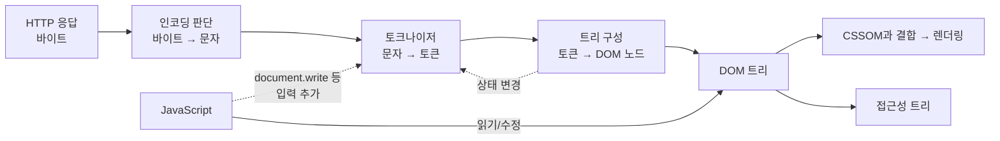

# HTML Parsing

> 📍 **커리큘럼 위치**: Track B · 1–3주 · Web Platform → HTML Parsing / Document 구조 / Semantic HTML (1/3)
>
> 이 페이지는 "HTML 문자열이 어떻게 DOM이 되는가"를 다룬다. 그렇게 만들어진 문서의 모양은 [Document 구조](document-structure.md), 그 구조에 담는 의미는 [Semantic HTML](semantic-html.md)에서 이어서 다룬다.

- [1. 학습 목표](#1-학습-목표)
- [2. 이 주제를 왜 배우는가](#2-이-주제를-왜-배우는가)
- [3. 핵심 개념과 용어](#3-핵심-개념과-용어)
- [4. 관련 계층과 역할 구분](#4-관련-계층과-역할-구분)
- [5. 내부 동작: 브라우저가 HTML을 파싱하는 흐름](#5-내부-동작-브라우저가-html을-파싱하는-흐름)
- [6. 코드 예제와 DOM·화면·상태 변화 해설](#6-코드-예제와-dom화면상태-변화-해설)
- [7. 흔한 오해·예외·주의점](#7-흔한-오해예외주의점)
- [8. 실무 적용, 접근성, 성능, 디버깅 관점](#8-실무-적용-접근성-성능-디버깅-관점)
- [9. 미리보기 개념 정리](#9-미리보기-개념-정리)
- [10. 핵심 정리](#10-핵심-정리)
- [11. 이해도 확인 질문](#11-이해도-확인-질문)

## 1. 학습 목표

- 브라우저가 받은 HTML 바이트가 **문자 → 토큰 → DOM 트리**로 바뀌는 단계를 순서대로 설명할 수 있다.
- **토크나이저**와 **트리 구성 단계**가 각각 무엇을 하는지, 왜 두 단계가 서로 영향을 주는지 설명할 수 있다.
- 잘못된 마크업(닫히지 않은 태그, 잘못된 중첩, 표 안의 엉뚱한 내용)이 DOM에서 어떻게 "고쳐지는지" 예측할 수 있다.
- "페이지 소스 보기"와 DevTools Elements 패널이 서로 다른 이유를 설명하고, 파싱 문제를 재현·검증할 수 있다.
- 파싱이 스크립트 실행, 접근성, 성능, React 렌더링과 어떻게 연결되는지 설명할 수 있다.

<details>
<summary>이 페이지에서 참고한 1차 출처</summary>

- [WHATWG HTML Standard — 13.2 Parsing HTML documents](https://html.spec.whatwg.org/multipage/parsing.html)
- [MDN — Populating the page: how browsers work](https://developer.mozilla.org/en-US/docs/Web/Performance/Guides/How_browsers_work)
- [MDN — Document Object Model (DOM) 소개](https://developer.mozilla.org/en-US/docs/Web/API/Document_Object_Model/Introduction)
- [MDN — Quirks mode and standards mode](https://developer.mozilla.org/en-US/docs/Web/HTML/Guides/Quirks_mode_and_standards_mode)
- [MDN — Content categories](https://developer.mozilla.org/en-US/docs/Web/HTML/Guides/Content_categories)
- [Nu HTML Checker (W3C)](https://validator.w3.org/nu/)

</details>

---

## 2. 이 주제를 왜 배우는가

우리가 작성하는 것은 **HTML 텍스트**이지만, 브라우저·CSS·JavaScript·React·스크린 리더가 실제로 다루는 것은 **DOM**이라는 객체 트리다. 이 둘은 같지 않다. 그 사이에서 텍스트를 트리로 바꾸는 과정이 **HTML 파싱**이다.

HTML은 매우 관대한 언어다. 태그를 닫지 않아도, `<html>`·`<head>`·`<body>`를 빼먹어도, 표 안에 아무 글자나 넣어도 페이지는 대개 "보인다". 하지만 그 이유는 브라우저가 대충 추측해서가 아니라, HTML 표준이 **잘못된 입력까지 포함해 모든 입력을 어떤 DOM으로 바꿀지 규칙으로 정해 두었기 때문**이다. [HTML 표준](https://html.spec.whatwg.org/multipage/parsing.html)은 문법적으로 올바른 HTML과 틀린 HTML 모두에 같은 파싱 규칙을 적용하며, 사용자 에이전트(브라우저)는 `text/html` 문서에서 DOM 트리를 만들 때 이 규칙을 따라야 한다고 명시한다.

문제는 그 "자동 수정" 결과가 작성자의 의도와 다를 수 있다는 점이다. 그러면 다음 같은 버그가 생긴다.

- CSS 선택자 `p .box`가 아무것도 선택하지 못한다. (`.box`가 사실 `<p>` 밖으로 밀려났다.)
- `querySelector`가 예상한 요소를 찾지 못하거나, 엉뚱한 부모를 반환한다.
- 서버에서 만든 HTML과 React가 기대한 DOM이 달라져 경고나 화면 깜빡임이 생긴다.
- 스크린 리더가 읽는 문서 구조가 화면에 보이는 구조와 다르다.
- 동기 스크립트가 파싱을 멈춰 첫 화면이 늦게 뜬다.

즉, 파싱을 이해하면 **"내가 쓴 코드"가 아니라 "브라우저가 실제로 만든 구조"를 기준으로 생각하고 디버깅**할 수 있다.

## 3. 핵심 개념과 용어

| 용어 | 정의 | 왜 중요한가 |
| --- | --- | --- |
| **파싱(Parsing)** | 정해진 문법에 따라 텍스트를 읽고, 프로그램이 다룰 수 있는 구조(여기서는 트리)로 바꾸는 과정 | 브라우저는 텍스트가 아니라 파싱 결과(DOM)로 일한다 |
| **바이트 스트림 / 문자 인코딩** | 네트워크로 오는 것은 0과 1의 바이트이고, 이를 문자로 해석하는 규칙이 인코딩(예: UTF-8)이다 | 인코딩을 잘못 판단하면 한글이 깨진다 |
| **토큰(Token)** | 파서가 의미 단위로 잘라 낸 조각. DOCTYPE, 시작 태그, 종료 태그, 주석, 문자, 파일 끝(EOF) 토큰이 있다 | 트리 구성 단계의 입력이 된다 |
| **토크나이저(Tokenizer)** | 문자를 하나씩 읽으며 상태를 바꿔 가는 상태 기계(state machine). 토큰을 만들어 낸다 | `<script>` 안의 `<`를 태그로 볼지 글자로 볼지 등을 결정한다 |
| **트리 구성(Tree construction)** | 토큰을 받아 DOM 노드를 만들고 트리의 어디에 붙일지 결정하는 단계 | 오류 복구(자동 수정)가 대부분 여기서 일어난다 |
| **DOM(Document Object Model)** | 문서를 노드와 객체의 트리로 표현하고, 프로그램이 그 구조·스타일·내용을 바꿀 수 있게 하는 프로그래밍 인터페이스 | CSS·JS·React·접근성이 모두 DOM을 기준으로 동작한다 |
| **열린 요소 스택(Stack of open elements)** | 아직 닫히지 않은 요소들을 순서대로 쌓아 둔 목록. 맨 위가 "현재 노드"다 | 새 노드가 어느 부모 밑에 들어갈지 결정한다 |
| **삽입 모드(Insertion mode)** | 트리 구성 단계가 지금 문서의 어느 부분을 처리 중인지 나타내는 상태(예: "in head", "in body", "in table") | 같은 토큰도 모드에 따라 다르게 처리된다 |
| **파스 에러(Parse error)** | HTML 문법 오류. 표준은 각 오류마다 어떻게 복구할지 정해 둔다 | 에러가 나도 페이지는 뜨지만, 결과 DOM이 의도와 다를 수 있다 |
| **빈 요소(Void element)** | 내용과 종료 태그를 가질 수 없는 요소. `br`, `img`, `input`, `meta`, `link`, `hr` 등 | `<div />`처럼 아무 요소에나 `/`를 붙여도 닫히지 않는 이유와 연결된다 |
| **직렬화(Serialization)** | 파싱의 반대. DOM 트리를 다시 HTML 문자열로 바꾸는 것. `innerHTML`을 읽을 때 일어난다 | DevTools와 `innerHTML`이 보여 주는 HTML은 원본이 아니라 직렬화 결과다 |

## 4. 관련 계층과 역할 구분

HTML 파싱을 정확히 이해하려면 "누가 무엇을 책임지는가"를 먼저 나눠야 한다.

| 계층 | 이 주제에서 하는 일 | 하지 않는 일 |
| --- | --- | --- |
| **네트워크 / HTTP** | HTML 바이트를 전달하고, `Content-Type: text/html; charset=utf-8` 헤더로 "이건 HTML이고 UTF-8이다"라는 힌트를 준다 | HTML 구조를 해석하지 않는다 (Track C · Network / HTTP에서 다룬다) |
| **HTML 파서 (브라우저 엔진)** | 바이트 → 문자 → 토큰 → DOM 노드를 만든다. 오류를 표준 규칙대로 복구한다 | 스타일 계산, 화면 배치, 그리기는 하지 않는다 |
| **DOM** | 파싱 결과를 객체 트리로 보관하고, 표준 API로 읽기·수정할 수 있게 한다 | DOM 자체는 프로그래밍 언어가 아니다. JavaScript가 사용하는 Web API다 |
| **CSS** | 별도 파서로 해석되어 CSSOM이 된다. DOM 노드에 선택자로 매칭된다 | HTML 구조를 바꾸지 않는다. 다만 파싱 결과가 달라지면 선택자 매칭 결과도 달라진다 |
| **JavaScript** | DOM을 읽고 바꾼다. 파싱 도중에 실행되어 파싱을 멈추게 할 수도 있다 | 파싱 규칙을 바꾸지는 못한다. `innerHTML` 등으로 파서를 "다시 호출"할 뿐이다 |
| **렌더링** | DOM + CSSOM으로 화면을 그린다 | 파싱이 끝날 때까지 기다리지 않고, 받은 만큼 먼저 그릴 수 있다 |
| **접근성 트리** | DOM을 바탕으로 보조 기술(스크린 리더 등)에 전달할 구조를 만든다 | 원본 HTML이 아니라 **파싱된 DOM**을 기준으로 한다 |
| **React** | JavaScript로 DOM API를 호출해 노드를 직접 만든다. 서버 렌더링을 쓰면 서버가 만든 HTML이 먼저 파서를 거친다 | 클라이언트에서 DOM API로 만든 노드는 HTML 파서를 거치지 않는다 → 파서의 자동 수정도 일어나지 않는다 |



> 🔎 핵심 관점: **DOM은 HTML 소스의 복사본이 아니라 "파서가 규칙대로 해석한 결과"**다. [MDN의 DOM 소개](https://developer.mozilla.org/en-US/docs/Web/API/Document_Object_Model/Introduction)도 DOM을 "문서의 객체 지향적 표현"이며, JavaScript의 일부가 아니라 JavaScript가 사용하는 Web API라고 설명한다.

## 5. 내부 동작: 브라우저가 HTML을 파싱하는 흐름

[HTML 표준의 파싱 모델](https://html.spec.whatwg.org/multipage/parsing.html)은 크게 두 단계다. 입력 문자를 **토큰화(tokenization)** 하고, 그 토큰으로 **트리를 구성(tree construction)** 해 DOM `Document`를 만든다. 그 앞에는 바이트를 문자로 바꾸는 디코딩 단계가 있다. 하나씩 따라가 보자.

### 5.1 바이트 → 문자: 인코딩 결정

네트워크에서 오는 것은 글자가 아니라 바이트다. "안녕"이라는 글자도 UTF-8에서는 6바이트, 옛 한국어 인코딩(EUC-KR)에서는 4바이트다. 브라우저는 다음 단서를 순서대로 살펴 인코딩을 결정한다.

1. 파일 맨 앞의 BOM(Byte Order Mark)
2. HTTP 응답의 `Content-Type` 헤더에 있는 `charset`
3. 문서 앞부분의 `<meta charset="utf-8">` 선언 (표준은 이 선언이 문서의 처음 1024바이트 안에 있어야 한다고 정한다)
4. 그래도 없으면 브라우저의 추측

인코딩 판단이 틀리면 한글이 `안녕`처럼 깨진다. 그래서 `<meta charset="utf-8">`은 `<head>`의 **가장 첫 줄**에 두는 것이 관례다. 이 선언보다 앞에 긴 주석이나 다른 태그가 있으면, 브라우저가 이미 다른 인코딩으로 읽기 시작했을 수 있다.

### 5.2 문자 → 토큰: 토크나이저

토크나이저는 **상태 기계**다. 현재 상태에서 문자 하나를 읽고, 그 문자에 따라 다음 상태로 넘어가거나 토큰을 내보낸다. [HTML 표준](https://html.spec.whatwg.org/multipage/parsing.html)의 토크나이저에는 84개의 상태가 정의되어 있고, 처음에는 "data state"에서 시작한다.

`<p class="note">Hi</p>`를 토큰화하면 대략 이렇게 흘러간다.

1. **data state**: `<`를 만나면 "태그가 시작되나 보다" → tag open state로 이동
2. **tag open state**: `p`(알파벳)를 만나면 새 시작 태그 토큰을 만들고 tag name state로 이동
3. **tag name state**: 공백을 만나면 태그 이름 `p` 확정 → 속성 이름을 기다리는 상태로 이동
4. 속성 관련 상태들을 거쳐 `class="note"`를 읽고, `>`를 만나면 **시작 태그 토큰** `{ p, class: "note" }`을 내보낸다
5. data state로 돌아와 `H`, `i`를 **문자 토큰**으로 내보낸다
6. `</p>`를 읽어 **종료 태그 토큰** `p`를 내보낸다

결과 토큰 열: `StartTag(p, class=note)` → `Character(H)` → `Character(i)` → `EndTag(p)`

중요한 점은 **토크나이저는 트리를 모른다**는 것이다. 토크나이저는 단지 글자를 잘라 줄 뿐이고, "이 `<p>`가 누구의 자식인가"는 다음 단계가 정한다.

#### 트리 구성 단계가 토크나이저의 상태를 바꾸는 경우

그런데 어떤 요소 안에서는 `<`를 태그 시작으로 보면 안 된다. 예를 들어 `<script>` 안의 `if (a < b)`의 `<`는 태그가 아니다. 그래서 트리 구성 단계는 특정 시작 태그를 만나면 **토크나이저의 상태를 직접 바꾼다**. [표준](https://html.spec.whatwg.org/multipage/parsing.html)에 따르면 `script` 시작 태그를 처리할 때 토크나이저는 "script data state"로 바뀐다.

| 요소 | 내용을 읽는 방식 | 결과 |
| --- | --- | --- |
| `script` | script data: `</script>`가 나올 때까지 거의 모든 것을 글자로 읽음 | `if (a < b)`가 태그로 오해되지 않는다 |
| `style` | RAWTEXT: 태그도, 문자 참조(`&amp;`)도 해석하지 않음 | CSS 코드가 그대로 보존된다 |
| `title`, `textarea` | RCDATA: 태그는 해석하지 않지만 `&amp;` 같은 문자 참조는 해석 | `<title><b>안내</b></title>`의 제목은 굵은 글씨가 아니라 문자 그대로 `<b>안내</b>` |

이것이 두 단계가 "한 방향 파이프라인"이 아니라 **서로 영향을 주는 구조**인 이유다.

### 5.3 토큰 → 트리: 트리 구성 단계

트리 구성 단계는 두 가지 상태를 들고 움직인다.

- **열린 요소 스택**: 지금 열려 있는 요소들. 새 노드는 보통 스택 맨 위(현재 노드)의 자식으로 들어간다.
- **삽입 모드**: 지금 문서의 어디쯤인지. 표준에는 "initial", "before html", "before head", "in head", "after head", "in body", "in table" 등 21개의 삽입 모드가 있다.

`<html>`, `<head>`, `<body>` 태그를 전부 생략한 다음 문서를 따라가 보자.

```html
<!doctype html><title>할 일</title><p>장보기
```

| 입력 토큰 | 삽입 모드 | 파서가 하는 일 | 열린 요소 스택 (아래 → 위) |
| --- | --- | --- | --- |
| DOCTYPE | initial | DocumentType 노드를 붙이고 렌더링 모드 결정 → "before html"로 | (비어 있음) |
| StartTag `title` | before html | `html` 시작 태그가 없으므로 **`html` 요소를 직접 만들고** 토큰을 다시 처리 | html |
| StartTag `title` | before head | `head` 시작 태그가 없으므로 **`head` 요소를 만들고** 다시 처리 | html, head |
| StartTag `title` | in head | `title` 요소를 만들고, 토크나이저를 RCDATA 상태로 바꿈 | html, head, title |
| 문자 "할 일", EndTag `title` | text → in head | 텍스트 노드를 붙이고 `title`을 스택에서 꺼냄 | html, head |
| StartTag `p` | in head → after head | `p`는 head에 올 수 없으므로 `head`를 닫고, **`body`를 만들고** 다시 처리 | html, body |
| StartTag `p`, 문자 "장보기" | in body | `p`를 만들고 텍스트를 붙임 | html, body, p |
| EOF | in body | 열린 요소를 모두 닫고 파싱 종료 | — |

[표준](https://html.spec.whatwg.org/multipage/parsing.html)은 이처럼 "before html", "before head", "after head" 모드에서 빠진 `html`·`head`·`body` 요소를 파서가 직접 만들어 넣도록 규정한다. 그래서 **HTML 문서의 DOM에는 소스에 태그가 없어도 언제나 `html`, `head`, `body`가 존재한다**.

### 5.4 오류 복구: 표준이 정한 "자동 수정" 규칙

과거에는 브라우저마다 잘못된 HTML을 다르게 처리해서, 같은 페이지가 브라우저마다 다른 DOM을 갖곤 했다. 현재 HTML 표준은 오류 처리 방법까지 알고리즘으로 정해 두었다. 그래서 같은 입력이면 주요 브라우저가 **같은 DOM**을 만든다. 대표적인 규칙들을 보자.

#### (1) 암묵적으로 닫히는 요소

`<p>`는 문단이고, 문단 안에는 문장 수준의 내용(phrasing content)만 올 수 있다. 그래서 `<p>`가 열린 상태에서 `<div>`, `<ul>`, `<h2>`, `<section>`, 또 다른 `<p>` 같은 블록 수준 시작 태그가 나오면, 파서는 **열린 `<p>`를 먼저 닫는다**.

- `<p>하나<p>둘` → `<p>하나</p><p>둘</p>` (형제)
- `<li>`도 비슷하다. `<li>사과<li>배` → 두 개의 형제 `li`
- 짝이 없는 `</p>`를 만나면 오류로 기록하고 **빈 `<p></p>`를 만든다**

#### (2) 표 안의 엉뚱한 내용: foster parenting

표(`table`) 구조 안에는 `tr`, `td` 같은 표 요소만 올 수 있다. 표 안에 일반 글자나 `<b>` 같은 요소가 직접 나오면, 파서는 그 내용을 **표 바로 앞으로 옮긴다**. 표준은 이를 "foster parenting(위탁 부모)"이라고 부른다. 또 `<table>` 바로 아래에 `<tr>`이 오면 `<tbody>`를 자동으로 만들어 끼워 넣는다.

#### (3) 엇갈린 서식 태그: adoption agency algorithm

`<b>굵게<i>둘 다</b>기울임</i>`처럼 서식 태그가 엇갈려 닫히면, 트리 구조로는 표현할 수 없다(트리에서는 부모가 자식보다 먼저 닫힐 수 없다). 표준의 "adoption agency algorithm"은 요소를 쪼개고 다시 만들어 `<b>굵게<i>둘 다</i></b><i>기울임</i>`로 재구성한다. 이 알고리즘은 `a`, `b`, `i`, `em`, `strong` 같은 서식 요소에 적용된다.

#### (4) 무시되거나 바뀌는 입력

- **중복 속성**: `<input id="a" id="b">`는 처음 나온 `id="a"`만 남는다.
- **빈 요소가 아닌 요소의 `/>`**: `<div />`의 `/`는 무시된다. 즉 `<div>`를 연 것과 같아서, 뒤의 내용이 전부 이 `div`의 자식이 된다. (JSX의 `<div />`는 HTML이 아니라 JavaScript 문법이라서 정상적으로 닫힌다. 두 언어를 혼동하지 말자.)
- **`<button>` 안의 `<button>`**: 안쪽 `button` 시작 태그를 만나면 바깥 `button`을 먼저 닫는다. 결과는 중첩이 아니라 **형제 버튼 두 개**다.
- **태그 이름·속성 이름의 대소문자**: HTML 요소에서는 소문자로 정규화된다. `<DIV CLASS="x">`는 DOM에서 `div`, `class`다.

> ⚠️ **파서가 모든 오류를 고쳐 주지는 않는다.** 위 규칙들은 "트리를 만들 수 없는" 상황을 처리하기 위한 것이다. 예를 들어 `<ul><div>항목</div></ul>`이나 `<a href="/"><button>열기</button></a>`는 HTML 콘텐츠 규칙상 올바르지 않지만 파서는 그대로 트리를 만든다. 이런 구조 오류는 DOM에 그대로 남아 접근성 문제를 일으키므로 **검사기(validator)로 따로 찾아야** 한다. 콘텐츠 규칙은 [Document 구조](document-structure.md)에서 자세히 다룬다.

### 5.5 점진적 파싱과 스크립트

#### 파서는 문서 전체를 기다리지 않는다

[MDN](https://developer.mozilla.org/en-US/docs/Web/Performance/Guides/How_browsers_work)에 따르면 브라우저는 첫 번째 데이터 덩어리(보통 약 14KB)를 받자마자 파싱을 시작하고, 가진 데이터만으로 화면을 그리려고 시도한다. 그래서 긴 문서도 위쪽부터 먼저 보인다. 이를 **점진적(incremental) 파싱**이라고 한다.

#### 동기 스크립트는 파싱을 멈춘다

그런데 파서가 `async`나 `defer`가 없는 일반 `<script>`를 만나면 사정이 달라진다. 스크립트는 `document.write()`로 파서 입력에 HTML을 끼워 넣을 수 있고, 지금까지 만들어진 DOM을 읽을 수도 있다. 그래서 브라우저는 안전을 위해 **스크립트를 내려받아 실행할 때까지 HTML 파싱을 멈춘다**. [MDN](https://developer.mozilla.org/en-US/docs/Web/Performance/Guides/How_browsers_work)도 `async`·`defer`가 없는 `<script>`가 렌더링을 막고 HTML 파싱을 멈춘다고 설명한다. 또 CSS를 기다리는 것은 HTML 파싱을 막지 않지만, 스크립트가 스타일 정보를 조회할 수 있으므로 **스크립트 실행은 막는다**.

#### 멈춘 동안에도 앞을 내다보는 파서

파싱이 멈춘 동안 시간을 낭비하지 않도록, 브라우저는 뒤쪽 마크업을 미리 훑어 CSS·스크립트·이미지 같은 리소스를 먼저 요청한다. [MDN](https://developer.mozilla.org/en-US/docs/Web/Performance/Guides/How_browsers_work)은 이를 **preload scanner**라고 부르고, [HTML 표준](https://html.spec.whatwg.org/multipage/parsing.html)은 같은 개념을 선택적 최적화인 "speculative HTML parsing(추측성 파싱)"으로 정의한다. 추측성 파서는 실제 DOM이나 파서 상태에 영향을 주지 않고 **리소스 요청만** 앞당긴다.

\[미리보기: script / async / defer / module\]

외부 스크립트는 HTML 파싱과 어떤 순서로 내려받고 실행되는지에 따라 첫 화면 시점과 DOM 접근 가능 시점이 달라진다. 각 속성의 정확한 실행 순서는 이 커리큘럼 1–3주 Web Platform의 "script / async / defer / module" 항목에서 자세히 다룬다.

### 5.6 HTML 파서를 쓰는 다른 입구

HTML 파서는 페이지를 처음 읽을 때만 쓰이지 않는다. JavaScript에서 HTML **문자열**을 DOM으로 바꾸는 API는 모두 같은 파싱 규칙을 쓴다.

- `element.innerHTML = '...'`, `element.insertAdjacentHTML(...)`
- `new DOMParser().parseFromString('...', 'text/html')`
- `<template>` 요소의 내용

이때 `innerHTML`은 **문맥(context) 요소**를 기준으로 파싱한다. `div.innerHTML`에 넣은 문자열은 "div 안에 있다고 가정하고" 파싱되므로, 표 요소처럼 특정 부모가 필요한 요소는 버려질 수 있다(6장 예제 5). 또 `innerHTML`로 넣은 `<script>`는 실행되지 않지만, 이것이 안전하다는 뜻은 아니다(6장 예제 5, 8장 보안 참고).

\[미리보기: DOM Manipulation\]

`createElement`, `append`처럼 문자열이 아닌 노드를 직접 만드는 API는 HTML 파서를 거치지 않는다. 노드 조작 API의 종류와 차이는 1–3주의 "DOM / Node / Element / DOM Manipulation" 항목에서 다룬다.

## 6. 코드 예제와 DOM·화면·상태 변화 해설

아래 예제는 모두 **브라우저 DevTools의 Console 탭**에 그대로 붙여 넣어 실행할 수 있다. 먼저 DOM 트리를 보기 쉽게 출력하는 도우미 함수를 만든다.

```javascript
// 요소와 (공백이 아닌) 텍스트 노드만 들여쓰기로 출력한다
function printTree(node, depth = 0) {
  const pad = '  '.repeat(depth);
  if (node.nodeType === Node.ELEMENT_NODE) {
    console.log(pad + node.nodeName.toLowerCase());
  } else if (node.nodeType === Node.TEXT_NODE && node.data.trim()) {
    console.log(pad + '#text "' + node.data.trim() + '"');
  }
  for (const child of node.childNodes) printTree(child, depth + 1);
}

// HTML 문자열을 "새 문서"로 파싱한다 (현재 페이지에는 영향 없음)
const parse = (html) => new DOMParser().parseFromString(html, 'text/html');
```

### 예제 1. 생략된 html / head / body

```javascript
const doc = parse('<!doctype html><title>할 일</title><p>장보기');
printTree(doc.documentElement);
```

```txt
html
  head
    title
      #text "할 일"
  body
    p
      #text "장보기"
```

**왜 이렇게 되는가**: 5.3절의 표처럼 파서가 "before html", "before head", "after head" 모드에서 빠진 요소를 직접 만들었다. 소스에는 `body`가 없지만 `doc.body`는 `null`이 아니다.

### 예제 2. 문단 안에 div를 넣으면

```javascript
const doc = parse('<p>소개<div class="box">상자</div>마무리</p>');
console.log(doc.body.innerHTML);
// <p>소개</p><div class="box">상자</div>마무리<p></p>
```

**단계별 해설**

1. `<p>`가 열리고 "소개"가 들어간다.
2. `<div>` 시작 태그 → `p` 안에는 블록 요소가 올 수 없으므로 파서가 **`p`를 먼저 닫는다**. `div`는 `body`의 자식이 된다.
3. "상자"는 `div` 안, `</div>`로 `div`가 닫힌다.
4. "마무리"는 이제 `body`에 직접 들어간다.
5. `</p>`를 만났지만 열린 `p`가 없다 → 오류로 기록하고 **빈 `<p></p>`를 만든다**.

**화면과 코드에 미치는 영향**

- CSS `p .box { ... }`는 아무것도 선택하지 못한다. `.box`는 `p`의 자손이 아니다.
- `p { color: gray }`는 "소개"에만 적용된다. "마무리"는 회색이 아니다.
- `doc.querySelector('p').textContent`는 "소개"뿐이다.
- 문서에 빈 문단이 하나 생기며, 일부 스크린 리더는 이를 빈 항목으로 탐색할 수 있다.

### 예제 3. 표 안의 글자와 자동 tbody

```javascript
const doc = parse('<table>메모<tr><td>A</td></tr></table>');
console.log(doc.body.innerHTML);
// 메모<table><tbody><tr><td>A</td></tr></tbody></table>
```

**왜 이렇게 되는가**

- "메모"는 표 안에 올 수 없는 글자다 → foster parenting으로 **표 앞으로 이동**했다. 화면에서도 "메모"가 표 위에 보인다.
- `<table>` 바로 아래의 `<tr>` → 파서가 `<tbody>`를 만들어 끼워 넣었다.

**React와의 연결**: 클라이언트에서 React가 DOM API로 `<table><tr>`을 만들면 HTML 파서를 거치지 않으므로 `tbody`가 **생기지 않는다**. 반면 서버에서 같은 컴포넌트를 HTML 문자열로 만들어 보내면 브라우저 파서가 `tbody`를 넣는다. 두 결과가 달라지는 것이다. React가 개발 모드에서 "`<tr>`은 `<table>`의 자식이 될 수 없다"는 식의 중첩 경고를 출력하는 이유가 여기에 있다.

\[미리보기: SSR / Hydration\]

서버가 만든 HTML 위에 React가 이벤트와 상태를 연결하는 과정을 hydration이라고 하며, 이때 서버 DOM과 클라이언트가 기대하는 구조가 다르면 불일치 오류가 난다. 렌더링 전략은 이후 React 아키텍처와 React × Backend 학습에서 다룬다.

### 예제 4. 엇갈린 서식 태그

```javascript
const doc = parse('<b>굵게<i>둘 다</b>기울임</i>');
console.log(doc.body.innerHTML);
// <b>굵게<i>둘 다</i></b><i>기울임</i>
```

**왜 이렇게 되는가**: `</b>`를 만났을 때 `i`가 아직 열려 있다. adoption agency algorithm이 `i`를 일단 닫고, `b` 바깥에 **새 `i` 요소를 다시 만들어** "기울임"을 담는다. 그 결과 DOM에는 `i`가 두 개 있다. `document.querySelectorAll('i').length`는 1이 아니라 2다.

### 예제 5. innerHTML의 문맥과 script

```javascript
const div = document.createElement('div');
div.innerHTML = '<tr><td>A</td></tr>';
console.log(div.innerHTML); // "A"  ← tr, td가 사라졌다

const tbody = document.createElement('tbody');
tbody.innerHTML = '<tr><td>A</td></tr>';
console.log(tbody.innerHTML); // "<tr><td>A</td></tr>"
```

**왜 이렇게 되는가**: `div` 문맥에서는 파서가 "in body" 모드로 시작한다. 이 모드에서 `tr`·`td` 시작 태그는 오류이므로 무시되고 글자 "A"만 남는다. `tbody` 문맥에서는 "in table body" 모드로 시작하므로 `tr`이 정상적으로 들어간다.

```javascript
const box = document.createElement('div');
box.innerHTML = '<script>console.log("실행될까?")<\/script>';
document.body.append(box); // 아무것도 출력되지 않는다

box.innerHTML = '';
document.body.append(box); // "실행됨" 출력
```

**왜 이렇게 되는가**: `innerHTML`로 삽입된 `script` 요소는 실행되지 않도록 표시된다. 하지만 `img`의 `onerror` 같은 **이벤트 핸들러 속성은 동작한다**. 그래서 "script가 안 돌아가니 innerHTML은 안전하다"는 생각은 틀렸다.

### 예제 6. 소스 보기와 Elements 패널 비교하기

아래 파일을 `parse-test.html`로 저장하고 브라우저로 연다.

```html
<!doctype html>
<title>파싱 실험</title>
<p>안내 문구
<ul>
  <li>사과
  <li>배
</ul>
<table>
  주의!
  <tr><td>A</td></tr>
</table>
```

1. **페이지 소스 보기**(`Ctrl/Cmd + U`): 서버가 보낸 텍스트 그대로다. `body`, `tbody`가 없다.
2. **DevTools → Elements**: 파싱된 DOM을 직렬화해서 보여 준다. `head`·`body`·`tbody`가 생겼고, `p`는 `ul` 앞에서 닫혔고, "주의!"는 표 앞으로 이동했다.
3. 화면에서도 "주의!"는 표 위쪽에 보인다.

## 7. 흔한 오해·예외·주의점

- **"브라우저가 알아서 대충 고친다"** → 대충이 아니다. 표준이 정한 알고리즘대로 고치며, 결과는 예측 가능하다. 다만 그 결과가 **내 의도와 같다는 보장은 없다**.
- **"화면이 깨지지 않으면 HTML이 올바르다"** → 예제 2처럼 화면은 멀쩡해 보여도 DOM 구조가 바뀌어 CSS·JS·접근성에 영향을 줄 수 있다.
- **"Elements 패널 = 내 HTML 소스"** → Elements 패널은 파싱 결과(그리고 이후 JS가 바꾼 결과)를 보여 준다. 원본은 "소스 보기"나 Network 탭의 응답 본문에서 확인한다.
- **"`<div />`로 닫을 수 있다"** → HTML에서 `/`는 빈 요소가 아니면 무시된다. JSX와 혼동하지 말자.
- **"태그를 생략하면 잘못된 HTML이다"** → HTML 표준은 일부 태그(`html`, `head`, `body`의 시작·종료 태그, `</li>`, `</p>` 등)의 생략을 특정 조건에서 **허용**한다. 하지만 팀 코드에서는 가독성과 실수 방지를 위해 명시적으로 쓰는 편이 낫다.
- **"innerHTML로 넣은 script가 실행되지 않으니 안전하다"** → 이벤트 핸들러 속성은 실행된다(예제 5).
- **적용 범위 주의 — XHTML**: 문서를 `application/xhtml+xml`로 전송하면 HTML 파서가 아니라 **XML 파서**가 쓰인다. XML 파서는 오류를 고쳐 주지 않고 문서 처리를 중단하는 엄격한 방식이다. 이 페이지의 오류 복구 규칙은 `text/html` 문서에만 해당한다.
- **적용 범위 주의 — 렌더링 모드**: 첫 줄의 `<!doctype html>`이 없으면 문서가 quirks 모드가 된다. 파싱 규칙과 CSS 동작 일부가 달라진다. 자세한 내용은 [Document 구조](document-structure.md)에서 다룬다.

## 8. 실무 적용, 접근성, 성능, 디버깅 관점

### 디버깅과 검증 방법

1. **원본과 DOM 비교**: "소스 보기"(원본) ↔ Elements 패널(DOM)을 나란히 비교한다. 다르다면 파서가 고쳤거나 JS가 바꾼 것이다.
2. **콘솔에서 최소 재현**: 의심되는 마크업 조각을 `new DOMParser().parseFromString(html, 'text/html')`로 파싱해 `body.innerHTML`을 확인한다. 현재 페이지를 건드리지 않고 파서 동작만 볼 수 있다.
3. **검사기 사용**: [W3C Nu HTML Checker](https://validator.w3.org/nu/)에 URL이나 HTML을 넣으면 파스 에러와 콘텐츠 규칙 위반을 알려 준다. [표준](https://html.spec.whatwg.org/multipage/parsing.html)도 적합성 검사기가 파스 에러를 보고해야 한다고 정한다.
4. **프레임워크 경고 읽기**: React 개발 모드의 "cannot be a descendant of", "cannot be a child of" 경고는 대부분 HTML 파싱·콘텐츠 규칙 문제다. 무시하지 말고 마크업을 고친다.

### 접근성 관점

접근성 트리는 원본 HTML이 아니라 **파싱된 DOM**에서 만들어진다. 그래서 파싱 결과가 바뀌면 스크린 리더 사용자가 경험하는 구조도 바뀐다.

- 중첩한 `<button>`은 형제 버튼 두 개가 되므로, 버튼 이름과 클릭 영역이 디자이너의 의도와 달라진다.
- 예제 2처럼 문단이 쪼개지면 "한 문단"으로 읽혀야 할 내용이 여러 조각과 빈 문단으로 읽힌다.
- 파서가 고치지 않는 콘텐츠 규칙 위반(`ul` 안의 `div` 등)은 목록 항목 수를 잘못 알리는 등 구조 정보를 망가뜨린다.

접근성은 "나중에 확인할 것"이 아니라 **올바른 파싱 결과를 만드는 것부터 시작하는 기능 요구사항**이다.

### 성능 관점

| 병목 원인 | 측정 방법 | 개선 방향과 효과 | 비용 / 주의점 |
| --- | --- | --- | --- |
| `head`의 동기 스크립트가 파싱을 멈춤 | DevTools Performance 패널에서 "Parse HTML" 작업이 끊기고 스크립트 평가가 끼어드는 구간 확인 | 스크립트 로딩 방식 변경(\[미리보기\] async/defer). 첫 화면 표시가 빨라진다 | 실행 순서·DOM 접근 시점이 바뀌므로 의존 관계를 확인해야 한다 |
| 중요 리소스를 JS로 늦게 주입 | Network 패널 Waterfall에서 해당 리소스 요청이 늦게 시작되는지 확인 | HTML 마크업에 직접 선언해 preload scanner가 일찍 발견하게 한다 | 모든 리소스를 앞당기면 오히려 대역폭 경쟁이 생긴다 |
| 지나치게 큰 HTML / 많은 DOM 노드 | Performance 패널의 Parse HTML 시간, Lighthouse의 DOM 크기 진단 | 불필요한 래퍼 요소 제거, 화면 밖 목록 분할 등. [MDN](https://developer.mozilla.org/en-US/docs/Web/Performance/Guides/How_browsers_work)에 따르면 DOM 노드가 많을수록 트리 구성이 오래 걸린다 | 구조를 줄이다 의미 요소까지 없애면 접근성이 나빠진다 |
| 첫 화면에 필요한 HTML이 문서 뒤쪽에 있음 | Performance 패널에서 첫 그리기 시점과 HTML 수신 타이밍 비교 | 첫 화면에 필요한 마크업을 앞쪽에 배치한다. 점진적 파싱 덕분에 먼저 보인다 | 서버 구조에 따라 스트리밍 응답 지원 여부가 다르다 |

### 보안 관점

사용자 입력을 `innerHTML`에 넣으면 그 문자열이 **HTML 파서를 거쳐 실제 요소가 된다**. 예제 5처럼 이벤트 핸들러 속성이 실행될 수 있다. 글자만 넣을 때는 `textContent`를 쓴다.

\[미리보기: XSS\]

신뢰할 수 없는 입력이 HTML·스크립트로 해석되어 실행되는 공격을 XSS(Cross-Site Scripting)라고 한다. 방어 방법은 13–15주 Network / Security에서 다룬다.

## 9. 미리보기 개념 정리

이 페이지에서 흐름상 잠깐 등장한 후속 개념들이다. 지금은 "이런 것이 있다" 정도만 알면 된다.

| 미리보기 개념 | 한 줄 요약 | 자세히 다루는 곳 |
| --- | --- | --- |
| script / async / defer / module | 스크립트를 언제 내려받고 언제 실행할지 정하는 속성 | 1–3주 Web Platform |
| DOM Manipulation | 노드를 직접 만들고 붙이는 API. HTML 파서를 거치지 않는다 | 1–3주 Web Platform |
| CSSOM / 렌더링 파이프라인 | DOM과 CSS가 결합되어 화면이 그려지는 과정 | 4–6주 Browser Internals |
| SSR / Hydration | 서버가 만든 HTML에 React가 동작을 연결하는 과정 | 이후 React 아키텍처 · React × Backend |
| XSS | 입력이 HTML·스크립트로 해석되어 실행되는 공격 | 13–15주 Network / Security |

## 10. 핵심 정리

> ✅ - HTML 파싱은 **바이트 → 문자(인코딩) → 토큰(토크나이저) → DOM(트리 구성)** 순서로 진행된다.
> - 토크나이저는 트리를 모르고 글자를 자를 뿐이며, 트리 구성 단계가 필요할 때 토크나이저 상태를 바꾼다(`script`, `style`, `title`, `textarea`).
> - 트리 구성 단계는 **열린 요소 스택**과 **삽입 모드**로 각 노드의 위치를 정한다.
> - 잘못된 마크업도 표준 알고리즘대로 복구된다: 빠진 `html`/`head`/`body` 생성, `p` 자동 닫힘, 표의 foster parenting과 `tbody` 삽입, 엇갈린 서식 태그 재구성.
> - 파서가 **고치지 않는** 콘텐츠 규칙 위반도 많으므로 검사기로 확인해야 한다.
> - 브라우저는 점진적으로 파싱하고, 일반 동기 스크립트는 파싱을 멈춘다. preload scanner(추측성 파싱)가 리소스 요청을 앞당긴다.
> - `innerHTML`·`DOMParser`도 같은 파서를 쓰며, 문맥 요소에 따라 결과가 달라진다.
> - 디버깅은 항상 **"내가 쓴 HTML"이 아니라 "파싱된 DOM"을 기준**으로 한다.

## 11. 이해도 확인 질문

> 📝 답을 정리한 뒤 대화창에서 답변하면 피드백을 받을 수 있다. 정답과 해설은 이 페이지에 쓰지 않는다.

1. **DOM 예측**: 다음 HTML이 파싱된 뒤의 `body.innerHTML`을 예측하고, CSS `p li { color: red; }`가 어떤 항목에 적용되는지 이유와 함께 설명하라.

`<p>준비물<ul><li>물</li><li>모자</li></ul></p>`

2. **React 버그 분석**: 서버 렌더링을 쓰는 React 앱에서 `<table>` 바로 안에 `<tr>`을 렌더링하는 컴포넌트가 있다. 개발 모드에서 경고가 뜨고 일부 화면이 다시 그려진다. 서버가 보낸 HTML로 만들어진 DOM과 클라이언트 React가 기대하는 DOM이 **어떻게, 왜** 다른지 설명하고 수정 방법을 제시하라.
3. **접근성 판단**: 디자이너가 "카드 전체가 버튼이고, 카드 안에 작은 '옵션' 버튼이 있는" UI를 요청해 `<button>카드 제목 <button>옵션</button></button>`으로 구현했다. 파싱 결과 DOM 구조를 예측하고, 스크린 리더와 마우스 사용자에게 각각 어떤 문제가 생기는지 설명하라.
4. **성능 진단**: 다음 `head`를 가진 페이지의 첫 화면이 늦다. 어떤 줄이 HTML 파싱을 멈추게 하는지, preload scanner가 일찍 발견할 수 있는 리소스와 없는 리소스는 무엇인지, DevTools의 어떤 화면에서 무엇을 보고 확인할지 설명하라.

`<head><meta charset="utf-8"><link rel="stylesheet" href="/app.css"><script src="/analytics.js"></script><script>const img = new Image(); img.src = '/hero.jpg';</script></head>`

5. **설계 선택 + 보안**: 댓글 내용을 화면에 표시하는 코드로 `commentEl.innerHTML = userInput`을 작성했다. `userInput`이 `<script>alert(1)</script>`일 때와 ``일 때 각각 어떤 일이 일어나는지 예측하고, 그 차이를 파싱 관점에서 설명한 뒤, 더 나은 대안을 제시하라.
