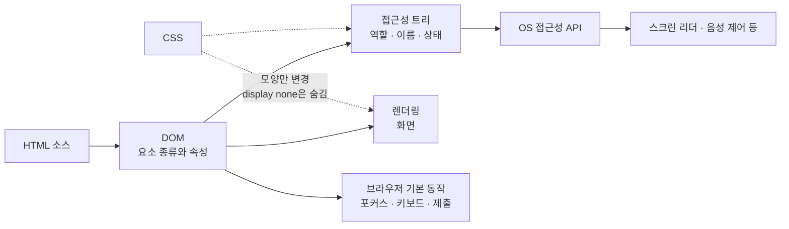
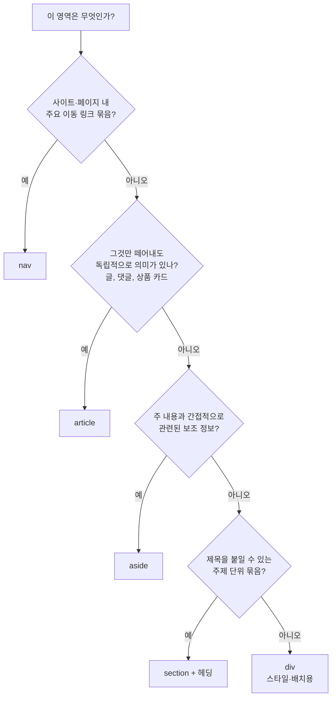

# Semantic HTML

> 📍 **커리큘럼 위치**: Track B · 1–3주 · Web Platform → HTML Parsing / Document 구조 / Semantic HTML (3/3)
>
> [HTML Parsing](html-parsing.md)에서 DOM이 만들어지는 과정을, [Document 구조](document-structure.md)에서 그 트리의 모양과 규칙을 봤다. 이 페이지는 트리의 각 요소가 **무엇을 의미하는지**, 그리고 그 의미가 누구에게 어떻게 전달되는지를 다룬다.

- [1. 학습 목표](#1-학습-목표)
- [2. 이 주제를 왜 배우는가](#2-이-주제를-왜-배우는가)
- [3. 핵심 개념과 용어](#3-핵심-개념과-용어)
- [4. 관련 계층과 역할 구분](#4-관련-계층과-역할-구분)
- [5. 내부 동작: 의미는 어떻게 전달되는가](#5-내부-동작-의미는-어떻게-전달되는가)
- [6. 코드 예제와 DOM·화면·상태 변화 해설](#6-코드-예제와-dom화면상태-변화-해설)
- [7. 흔한 오해·예외·주의점](#7-흔한-오해예외주의점)
- [8. 실무 적용, 접근성, 성능, 디버깅 관점](#8-실무-적용-접근성-성능-디버깅-관점)
- [9. 미리보기 개념 정리](#9-미리보기-개념-정리)
- [10. 핵심 정리](#10-핵심-정리)
- [11. 이해도 확인 질문](#11-이해도-확인-질문)

## 1. 학습 목표

- "시맨틱(의미)"이 무엇이며, **보이는 모양과 의미를 분리**해야 하는 이유를 설명할 수 있다.
- 요소의 의미가 브라우저 기본 동작, 접근성 트리, 보조 기술로 전달되는 흐름을 설명할 수 있다.
- **암묵적 역할(implicit role)**, **랜드마크(landmark)**, **헤딩 구조**를 설명하고 페이지 뼈대를 설계할 수 있다.
- `div`/`span`과 의미 요소(`button`, `a`, `nav`, `main`, `article`, `section` 등)를 선택하는 기준을 말할 수 있다.
- "ARIA의 첫 번째 규칙"을 이해하고, 네이티브 요소를 흉내 내는 비용을 설명할 수 있다.
- DevTools 접근성 패널, 키보드 테스트 등으로 시맨틱을 검증할 수 있다.

<details>
<summary>이 페이지에서 참고한 1차 출처</summary>

- [W3C — HTML Accessibility API Mappings (HTML-AAM)](https://www.w3.org/TR/html-aam-1.0/)
- [W3C — Using ARIA](https://www.w3.org/TR/using-aria/)
- [W3C WAI — ARIA Authoring Practices: Landmark Regions](https://www.w3.org/WAI/ARIA/apg/practices/landmark-regions/)
- [W3C WAI — Understanding WCAG 2.2 SC 1.3.1 Info and Relationships](https://www.w3.org/WAI/WCAG22/Understanding/info-and-relationships.html)
- [MDN — ](https://developer.mozilla.org/en-US/docs/Web/HTML/Reference/Elements/Heading_Elements)[`<h1>`](https://developer.mozilla.org/en-US/docs/Web/HTML/Reference/Elements/Heading_Elements)[–](https://developer.mozilla.org/en-US/docs/Web/HTML/Reference/Elements/Heading_Elements)[`<h6>`](https://developer.mozilla.org/en-US/docs/Web/HTML/Reference/Elements/Heading_Elements)[ heading elements](https://developer.mozilla.org/en-US/docs/Web/HTML/Reference/Elements/Heading_Elements)
- [MDN — Content categories](https://developer.mozilla.org/en-US/docs/Web/HTML/Guides/Content_categories)

</details>

---

## 2. 이 주제를 왜 배우는가

다음 두 줄은 CSS를 입히면 화면에서 **똑같이** 보일 수 있다.

```html
<div class="btn" onclick="save()">저장</div>
<button type="button" class="btn" onclick="save()">저장</button>
```

하지만 사용자가 경험하는 것은 전혀 다르다.

| 확인 항목 | `div` | `button` |
| --- | --- | --- |
| Tab 키로 이동 | 불가 — 포커스를 받지 않는다 | 가능 |
| Enter / Space로 실행 | 불가 | 가능 — 브라우저가 click 이벤트를 만들어 준다 |
| 스크린 리더 안내 | "저장" (그냥 글자) | "저장, 버튼" |
| `disabled` 상태 | 불가 — 직접 구현해야 한다 | 가능 — 클릭·포커스 차단, 비활성 상태 전달 |
| 음성 제어("저장 버튼 클릭") | 찾기 어렵다 | 가능 |

화면을 **보면서 마우스로** 쓰는 사람에게는 차이가 없지만, 키보드 사용자, 스크린 리더 사용자, 음성 제어 사용자에게는 `div` 버튼이 **존재하지 않거나 쓸 수 없는** 기능이 된다. [WCAG 2.2의 1.3.1 Info and Relationships](https://www.w3.org/WAI/WCAG22/Understanding/info-and-relationships.html)는 "표현으로 전달되는 정보, 구조, 관계는 프로그램이 판단할 수 있어야 한다"고 요구한다. 시맨틱 HTML은 이 요구사항을 만족시키는 **가장 기본적이고 비용이 적은 방법**이다.

또한 의미가 있는 마크업은 개발자에게도 이득이다. `<nav>`, `<main>`, `<article>`은 `<div class="nav">`보다 코드의 의도를 바로 드러내고, 테스트 코드가 "역할"로 요소를 찾을 수 있게 해 준다.

## 3. 핵심 개념과 용어

| 용어 | 정의 |
| --- | --- |
| **시맨틱(Semantics)** | 요소가 "어떻게 보이는가"가 아니라 "무엇인가"를 나타내는 의미. 예: `h2`는 "큰 글씨"가 아니라 "2단계 제목" |
| **의미 요소 / 범용 요소** | `nav`, `button`, `ul`처럼 고유한 의미가 있는 요소와, `div`, `span`처럼 의미가 없는 범용 컨테이너(generic) |
| **보조 기술(Assistive Technology)** | 스크린 리더, 화면 확대기, 음성 제어, 스위치 장치처럼 장애가 있는 사용자가 컴퓨터를 쓰도록 돕는 소프트웨어·하드웨어 |
| **접근성 트리(Accessibility tree)** | 브라우저가 DOM을 바탕으로 만든, 보조 기술용 트리. 각 노드에 역할·이름·상태가 있다 |
| **역할(Role)** | "이것은 버튼이다", "이것은 목록이다"처럼 노드의 종류. 보조 기술은 역할을 보고 사용법을 안내한다 |
| **암묵적 역할(Implicit role)** | HTML 요소가 따로 지정하지 않아도 기본으로 갖는 역할. 예: `button` → button, `nav` → navigation |
| **랜드마크(Landmark)** | 페이지의 큰 영역(머리글, 내비게이션, 주요 내용, 보조 정보, 바닥글 등)을 나타내는 역할. 스크린 리더 사용자가 영역 단위로 건너뛸 수 있게 한다 |
| **헤딩(Heading)** | `h1`–`h6`. 내용의 계층 구조를 나타낸다. 스크린 리더 사용자가 가장 많이 쓰는 탐색 수단 중 하나다 |
| **WAI-ARIA** | HTML만으로 표현할 수 없는 역할·상태를 속성(`role`, `aria-*`)으로 덧붙이는 W3C 명세. 의미만 바꾸고 **동작은 추가하지 않는다** |

## 4. 관련 계층과 역할 구분

| 계층 | 시맨틱과 관련해 하는 일 |
| --- | --- |
| **HTML** | 요소 선택으로 의미를 **선언**한다. 시맨틱의 출발점이다 |
| **CSS** | 모양만 바꾼다. `h2`를 작게 보이게 해도 2단계 제목이라는 의미는 그대로다. 단, `display: none`, `visibility: hidden`은 요소를 접근성 트리에서도 숨긴다 |
| **DOM** | 요소의 종류와 속성을 객체로 보관한다. 의미는 DOM에 저장된 요소 종류·속성에서 나온다 |
| **브라우저 (기본 동작)** | 의미 요소에 내장 기능을 준다: 포커스, 키보드 조작, 폼 제출, 링크 이동, 기본 스타일 |
| **브라우저 (접근성 트리)** | DOM을 역할·이름·상태로 변환해 운영체제의 접근성 API에 전달한다. 이 매핑 규칙은 [HTML-AAM](https://www.w3.org/TR/html-aam-1.0/)이 정한다 |
| **보조 기술** | 접근성 API를 통해 정보를 읽고, 사용자에게 "버튼", "목록 3개 항목", "내비게이션 영역"처럼 안내한다 |
| **JavaScript** | 동작을 추가한다. 의미 요소를 쓰지 않으면 브라우저 기본 동작을 JS로 **다시 만들어야** 한다 |
| **React** | JSX의 `<button>`은 DOM `button` 요소가 된다. 따라서 의미는 그대로 유지된다. 하지만 컴포넌트 이름(`<Button>`)은 의미가 아니다. **컴포넌트가 실제로 어떤 DOM 요소를 렌더링하는지**가 의미를 결정한다 |



## 5. 내부 동작: 의미는 어떻게 전달되는가

### 5.1 DOM에서 접근성 트리로

브라우저는 DOM을 만든 뒤, 각 노드를 **역할(role)**, **이름(name)**, **상태(state)** 정보로 바꾼 접근성 트리를 만든다. [HTML-AAM](https://www.w3.org/TR/html-aam-1.0/)은 HTML 요소와 속성을 플랫폼 접근성 API에 어떻게 매핑할지 정의해, 브라우저마다 같은 정보를 노출하도록 한다.

| HTML | 암묵적 역할 | 스크린 리더 안내 예 |
| --- | --- | --- |
| `<button>저장</button>` | button | "저장, 버튼" |
| `<a href="/help">도움말</a>` | link | "도움말, 링크" |
| `<a>도움말</a>` (href 없음) | generic | "도움말" (링크가 아님) |
| `<ul>`  • `<li>` 3개 | list / listitem | "목록, 항목 3개" |
| `<nav>` | navigation | "내비게이션" |
| `<h2>배송 정보</h2>` | heading (level 2) | "배송 정보, 제목 수준 2" |
| `<div>`, `<span>` | generic | 내용 글자만 읽는다 |

(위 역할 매핑 중 `button`, `a`, `ul`, `nav`는 [HTML-AAM](https://www.w3.org/TR/html-aam-1.0/)의 매핑 표를 따른다. 실제 안내 문구는 스크린 리더와 언어 설정에 따라 다르다.)

\[미리보기: Accessible Name\]

"저장, 버튼"의 "저장"처럼 보조 기술이 요소를 부르는 이름을 accessible name이라고 하며, 내용 텍스트·`label`·`aria-label` 등 정해진 순서로 계산된다. 계산 규칙은 바로 다음 학습인 "Form / Input / Accessibility 기초"에서 자세히 다룬다.

### 5.2 기본 동작: 의미가 공짜로 주는 기능

의미 요소를 쓰면 브라우저가 **수많은 동작을 무료로** 제공한다.

**`<button>`**

- 키보드 포커스를 받는다(Tab 순서에 포함).
- Enter, Space로 실행하면 브라우저가 click 이벤트를 발생시킨다.
- `disabled`이면 클릭·포커스가 막히고 "비활성" 상태가 전달된다.
- `form` 안에서는 **기본 `type`이 `submit`**이다. 폼 제출이 목적이 아니면 `type="button"`을 반드시 쓴다.

**`<a href>`**

- 포커스, Enter로 이동
- 새 탭으로 열기(Ctrl/Cmd+클릭, 가운데 클릭), 링크 주소 복사, 방문 여부 표시
- 브라우저 뒤로 가기·앞으로 가기와 자연스럽게 연결

**링크 vs 버튼 선택 기준**

- **다른 위치(URL)로 이동**한다 → `<a href>`
- **현재 페이지에서 동작을 실행**한다(저장, 열기, 삭제, 토글) → `<button>`
- "버튼처럼 보이는 링크", "링크처럼 보이는 버튼"은 CSS로 해결한다. 모양이 아니라 **동작의 종류**로 요소를 고른다.

### 5.3 문서의 뼈대: 랜드마크

스크린 리더 사용자는 페이지 전체를 처음부터 끝까지 듣지 않는다. 랜드마크 목록을 불러 "주요 내용"으로 바로 건너뛰거나, 내비게이션만 골라 이동한다. [WAI-ARIA Authoring Practices](https://www.w3.org/WAI/ARIA/apg/practices/landmark-regions/)가 정리한 HTML 요소와 랜드마크의 대응은 다음과 같다.

| HTML 요소 | 랜드마크 역할 | 조건 |
| --- | --- | --- |
| `header` | banner | `body` 문맥일 때만. `article`, `aside`, `main`, `nav`, `section` 안에 있으면 랜드마크가 아니다 |
| `nav` | navigation | 항상 |
| `main` | main | 항상. 페이지의 주요 내용은 하나 |
| `aside` | complementary | 항상 |
| `footer` | contentinfo | `body` 문맥일 때만. `header`와 같은 조건 |
| `section` | region | **접근 가능한 이름이 있을 때만** (`aria-labelledby`, `aria-label` 등) |
| `form` | form | 접근 가능한 이름이 있을 때만 |
| `search` | search | 항상 |

조건에 주목하자. `article` 안의 `header`는 "그 글의 머리말"일 뿐 페이지 전체의 banner가 아니다. 이름 없는 `section`은 랜드마크가 되지 않는다. 같은 종류의 랜드마크(예: `nav` 두 개)가 여러 개면 "주 메뉴", "푸터 메뉴"처럼 이름을 붙여 구분해야 사용자가 헷갈리지 않는다.

### 5.4 헤딩 구조

헤딩은 문서의 목차다. 스크린 리더 사용자는 헤딩 목록을 불러 원하는 부분으로 이동하고, H 키로 다음 헤딩으로 건너뛴다.

[MDN](https://developer.mozilla.org/en-US/docs/Web/HTML/Reference/Elements/Heading_Elements)이 권장하는 원칙은 다음과 같다.

- 페이지에는 보통 **`h1` 하나**를 두고, 페이지 내용을 설명하게 한다(`title`과 비슷한 역할).
- **단계를 건너뛰지 않는다**: `h1` 다음 `h2`, 그 다음 `h3`. 건너뛰면 사용자는 "중간 제목을 놓쳤나?" 하고 헷갈린다.
- 하위 구획을 닫고 상위로 돌아갈 때는 `h3` → `h2`처럼 올라가는 것이 자연스럽다.
- **글자 크기로 헤딩 단계를 고르지 않는다.** 크기는 CSS로 조절한다.

> 📜 **역사적 배경: "문서 개요 알고리즘(outline algorithm)"은 없다**
>
> 예전 HTML5 명세에는 `section` 안의 `h1`을 자동으로 하위 단계로 계산하는 알고리즘이 있었지만, 브라우저와 보조 기술이 이를 구현하지 않았다. [MDN](https://developer.mozilla.org/en-US/docs/Web/HTML/Reference/Elements/Heading_Elements)에 따르면 중첩된 구획마다 `h1`을 쓰는 방식은 이제 표준상 부적합(non-conforming)하다. 또한 2025년 5월 이전 표준은 `section`·`article`·`aside`·`nav` 안의 `h1`을 `h2`처럼 작게 그리도록 정했지만, 이 기본 스타일은 이후 제거되었다. 즉 **헤딩의 단계는 숫자(`h1`–`h6`)로 직접 표현**해야 한다.

### 5.5 구획 요소 선택하기: article, section, aside, nav, div



- **`article`**: 독립적으로 배포·재사용해도 의미가 통하는 단위. 블로그 글, 뉴스 기사, 댓글, 상품 카드.
- **`section`**: 주제별로 묶인 구획. 보통 헤딩을 가진다. "스타일을 주려고 감싼 상자"라면 `section`이 아니라 `div`다.
- **`aside`**: 주 내용과 간접적으로 관련된 내용. 사이드바, 관련 글, 용어 설명 박스.
- **`div`**: 의미 없는 컨테이너. Flex/Grid 배치를 위한 래퍼처럼 **의미가 필요 없을 때는 `div`가 정답**이다. 시맨틱 HTML은 `div`를 쓰지 말자는 것이 아니라, **의미가 있는 곳에 의미 요소를 쓰자**는 것이다.

### 5.6 텍스트 수준의 의미

| 요소 | 의미 | 헷갈리는 짝 |
| --- | --- | --- |
| `strong` | 중요함, 심각함, 긴급함 | `b`: 중요하지 않지만 시각적으로 구분할 키워드 (예: 제품명) |
| `em` | 강세. 문장의 뜻을 바꾸는 강조 | `i`: 다른 목소리·분위기의 텍스트 (외래어, 학명, 생각) |
| `time` | 날짜·시간. `datetime` 속성으로 기계가 읽을 수 있는 값 제공 | 그냥 텍스트 "어제" |
| `code`, `kbd` | 코드 조각 / 사용자가 입력하는 키 | `span class="mono"` |
| `blockquote`, `q`, `cite` | 긴 인용 / 짧은 인라인 인용 / 작품 제목 | 들여쓰기용 `blockquote` 남용 |
| `abbr` | 약어 | — |

`b`와 `i`는 폐기된 요소가 아니다. HTML5에서 의미가 재정의되었을 뿐이다. 단순히 굵게·기울게 보이고 싶은 것이라면 CSS(`font-weight`, `font-style`)를 쓴다.

### 5.7 목록, 표, 이미지

- **목록**: 순서 없는 묶음은 `ul`, 순서가 중요하면 `ol`, 용어-설명 쌍은 `dl`/`dt`/`dd`. 스크린 리더는 "목록, 항목 5개"처럼 개수를 알려 주므로, 사용자가 얼마나 긴지 미리 알 수 있다. 내비게이션 메뉴도 보통 `nav > ul > li > a` 구조다.
- **표**: **표 형식의 데이터**에만 `table`을 쓴다. `caption`(표 제목), `th`(머리글 칸)와 `scope="col"`/`scope="row"`를 쓰면 스크린 리더가 칸을 이동할 때 "열 머리글: 가격, 12,000원"처럼 맥락을 읽어 준다. 레이아웃을 위해 `table`을 쓰지 않는다(그것은 CSS Grid의 역할).
- **이미지**: `img`의 `alt`는 이미지를 대신하는 텍스트다. 정보를 전달하는 이미지에는 그 정보를 쓰고, 장식용 이미지는 `alt=""`로 비워 보조 기술이 건너뛰게 한다. `alt` 속성 자체를 빼면 일부 스크린 리더가 파일 이름을 읽는다. 이미지와 설명을 묶을 때는 `figure`/`figcaption`을 쓴다.

### 5.8 ARIA는 언제 쓰는가

[Using ARIA](https://www.w3.org/TR/using-aria/)의 첫 번째 규칙은 이렇다. 필요한 의미와 동작이 이미 내장된 네이티브 HTML 요소나 속성을 쓸 수 있다면, 다른 요소에 ARIA 역할·상태·속성을 붙여 바꾸는 대신 **네이티브 요소를 써라**. 두 번째 규칙은 **꼭 필요하지 않다면 네이티브 의미를 바꾸지 말라**는 것이다.

이유는 ARIA가 **의미만 바꾸고 동작은 하나도 추가하지 않기 때문**이다. `<div role="button">`은 스크린 리더에게 "버튼"이라고 말하지만, 포커스도, Enter/Space 실행도, `disabled`도 생기지 않는다. 결국 "버튼이라고 소개됐는데 눌리지 않는" 더 나쁜 상태가 될 수 있다. ARIA는 탭 패널, 콤보박스처럼 **HTML에 대응 요소가 없는 위젯**을 만들 때 쓰는 도구다.

\[미리보기: ARIA 속성과 위젯 패턴\]

`aria-expanded`, `aria-controls` 같은 상태·관계 속성과 복합 위젯의 키보드 패턴은 "Form / Input / Accessibility 기초"와 이후 접근성 심화 학습에서 다룬다.

## 6. 코드 예제와 DOM·화면·상태 변화 해설

### 예제 1. div 버튼을 "제대로" 흉내 내는 비용

`<button>`이 무료로 주는 기능을 `div`로 직접 구현하면 이 정도가 필요하다.

```html
<div class="btn" role="button" tabindex="0" id="fake">저장</div>

<script>
  const fake = document.getElementById('fake');
  const save = () => console.log('저장됨');

  fake.addEventListener('click', save);
  fake.addEventListener('keydown', (e) => {
    if (e.key === 'Enter') save();
    if (e.key === ' ') e.preventDefault(); // Space의 페이지 스크롤 막기
  });
  fake.addEventListener('keyup', (e) => {
    if (e.key === ' ') save(); // 네이티브 버튼은 Space를 뗄 때 실행된다
  });
</script>
```

**각 줄이 하는 일**

- `role="button"`: 접근성 트리에서 역할을 button으로 바꾼다. **의미만** 바뀐다.
- `tabindex="0"`: Tab 순서에 넣어 포커스를 받게 한다.
- `keydown`/`keyup`: Enter와 Space 동작을 직접 만든다.

**그래도 빠진 것**: `disabled` 처리, 폼 제출·리셋, 고대비 모드의 시스템 버튼 스타일, 음성 제어 연동의 일부 등. 반면 네이티브 버전은 한 줄이다.

```html
<button type="button" class="btn" onclick="console.log('저장됨')">저장</button>
```

\[미리보기: preventDefault\]

`e.preventDefault()`는 브라우저의 기본 동작(여기서는 Space 키의 스크롤)을 취소한다. 정확한 동작과 `stopPropagation`과의 차이는 1–3주의 "preventDefault / stopPropagation" 항목에서 다룬다.

### 예제 2. "div 수프"를 시맨틱 구조로 바꾸기

**Before**: 모든 것이 `div`

```html
<div class="header">
  <div class="logo">마이 블로그</div>
  <div class="menu">
    <div onclick="location.href='/'">홈</div>
    <div onclick="location.href='/posts'">글 목록</div>
  </div>
</div>
<div class="content">
  <div class="post">
    <div class="title">HTML 파싱 정리</div>
    <div class="date">2026.10.17</div>
    <div class="body">파서는 토큰을 만들고...</div>
  </div>
</div>
<div class="sidebar">관련 글...</div>
<div class="footer">© 2026 마이 블로그</div>
```

**After**: 의미 요소 사용

```html
<header>
  <a href="/" class="logo">마이 블로그</a>
  <nav aria-label="주 메뉴">
    <ul>
      <li><a href="/">홈</a></li>
      <li><a href="/posts">글 목록</a></li>
    </ul>
  </nav>
</header>
<main>
  <article>
    <h1>HTML 파싱 정리</h1>
    <p><time datetime="2026-10-17">2026.10.17</time></p>
    <p>파서는 토큰을 만들고...</p>
  </article>
</main>
<aside aria-labelledby="related-title">
  <h2 id="related-title">관련 글</h2>
  ...
</aside>
<footer>© 2026 마이 블로그</footer>
```

**화면 변화**: CSS를 같게 맞추면 화면은 거의 같다. 바뀐 것은 **DOM의 요소 종류**와, 그로부터 만들어지는 **접근성 트리**다.

| 스크린 리더 기능 | Before | After |
| --- | --- | --- |
| 랜드마크 목록 | (없음) | 배너, 내비게이션 "주 메뉴", 기본(main), 보조 "관련 글", 콘텐츠 정보 |
| 헤딩 목록 | (없음) | 제목 1 "HTML 파싱 정리", 제목 2 "관련 글" |
| 링크 목록 | (없음 — 클릭 가능한 div는 링크가 아니다) | "마이 블로그", "홈", "글 목록" |
| 메뉴 안내 | 글자만 연속으로 읽음 | "목록, 항목 2개" |
| 키보드 | 메뉴에 Tab으로 갈 수 없다 | Tab으로 모든 링크에 이동, Enter로 이동 |

`header`와 `footer`가 `body`의 직계 영역에 있으므로 banner와 contentinfo가 되었다. 만약 `article` 안에 `<header>`를 넣는다면 그것은 글의 머리말일 뿐 banner가 아니다.

### 예제 3. 폼 안의 버튼 기본값

```html
<form action="/search">
  <input name="q" aria-label="검색어">
  <button onclick="this.form.q.value = ''">지우기</button>
  <button>검색</button>
</form>
```

**무슨 일이 일어나나**: "지우기"를 누르면 입력값이 지워진 **직후 폼이 제출**되어 페이지가 이동한다. `form` 안의 `button`은 `type`을 지정하지 않으면 `submit`이기 때문이다. 고치려면 `<button type="button">지우기</button>`로 명시한다. "검색" 버튼은 제출이 목적이므로 `type="submit"`을 명시해 두면 의도가 더 분명해진다.

### 예제 4. React 컴포넌트가 의미를 깨뜨리는 경우

```javascript
function TodoItem({ text }) {
  return (
    <div className="row">
      <li>{text}</li>
    </div>
  );
}

function TodoList({ items }) {
  return (
    <ul>
      {items.map((item) => <TodoItem key={item.id} text={item.text} />)}
    </ul>
  );
}
```

**결과 DOM**: `ul > div.row > li`. `ul`의 자식은 `li`여야 하는데 `div`가 끼었다. React는 DOM API로 노드를 직접 만들기 때문에 HTML 파서의 자동 수정도 일어나지 않고, 이 잘못된 구조가 **그대로 DOM에 남는다**. 일부 브라우저·스크린 리더 조합에서는 목록 항목 수를 잘못 알리거나 목록으로 인식하지 않는다.

**수정**: 스타일용 래퍼가 필요 없다면 `li` 자체에 클래스를 준다.

```javascript
function TodoItem({ text }) {
  return <li className="row">{text}</li>;
}
```

컴포넌트가 여러 요소를 반환해야 하는데 래퍼 `div`를 만들고 싶지 않다면 Fragment(`<>...</>`)를 쓴다. Fragment는 DOM에 아무 노드도 만들지 않으므로 `ul > li`, `tr > td` 같은 부모-자식 규칙을 지킬 수 있다.

### 예제 5. 크기 때문에 고른 헤딩

```html
<h1>장바구니</h1>
<h4>배송 정보</h4>   <!-- "작게 보이고 싶어서" h4 -->
<h2>결제 수단</h2>
```

헤딩 목록은 "제목 1 장바구니 → 제목 4 배송 정보 → 제목 2 결제 수단"이 되어, 사용자는 h2와 h3를 놓친 것처럼 느낀다. **의미에 맞게 `h2`를 쓰고 크기는 CSS로** 조절한다.

```html
<h2 class="heading-sm">배송 정보</h2>
```

## 7. 흔한 오해·예외·주의점

- **"시맨틱 HTML은 SEO를 위한 것"** → 검색 엔진도 이득을 보지만, 핵심은 **접근성과 브라우저 기본 동작**이다.
- **"`div`를 쓰면 안 된다"** → 의미가 필요 없는 배치용 컨테이너는 `div`가 정답이다.
- **"`section`은 `div`의 시맨틱 버전"** → `section`은 제목을 붙일 수 있는 주제 단위다. 이름이 없는 `section`은 랜드마크도 되지 않는다.
- **"`header`/`footer`는 항상 페이지 머리글/바닥글"** → `body` 문맥일 때만 banner/contentinfo다.
- **"ARIA를 많이 붙일수록 접근성이 좋아진다"** → ARIA는 동작을 추가하지 않는다. 네이티브 요소가 먼저다.
- **"`<nav role="navigation">`처럼 역할을 명시해야 한다"** → 암묵적 역할과 같은 `role`은 중복이다. 아주 오래된 브라우저 지원 목적이 아니라면 필요 없다.
- **"섹션마다 `h1`을 써도 알아서 단계가 계산된다"** → 그런 알고리즘은 구현되지 않았고 현재 표준상 부적합하다.
- **"CSS는 의미에 영향이 없다"** → 대체로 맞지만 예외가 있다. `display: none`, `visibility: hidden`은 접근성 트리에서도 요소를 숨긴다. 또 Safari(WebKit)는 `list-style: none`인 목록을 목록으로 알리지 않는 경우가 있는 것으로 알려져 있으므로, 목록 표시를 지운 UI는 실제 보조 기술로 확인해야 한다.
- **"클릭 이벤트를 달면 버튼이다"** → 클릭 핸들러는 동작일 뿐 의미가 아니다. 키보드·보조 기술 사용자는 접근할 수 없다.

## 8. 실무 적용, 접근성, 성능, 디버깅 관점

### 요소 선택 체크리스트

- [ ] 이동이면 `a href`, 동작이면 `button`인가 (`form` 안의 `button`은 `type`을 명시했는가)
- [ ] 페이지에 `main`이 하나 있고, 머리글·내비게이션·바닥글이 랜드마크로 표현되는가
- [ ] 같은 종류의 랜드마크가 여러 개라면 이름으로 구분했는가
- [ ] `h1`이 하나이고 헤딩 단계를 건너뛰지 않는가 (크기는 CSS로)
- [ ] 항목 묶음은 목록, 표 형식 데이터는 `table` + `th`로 표현했는가
- [ ] 정보 이미지에는 의미 있는 `alt`, 장식 이미지에는 `alt=""`가 있는가
- [ ] ARIA를 쓰기 전에 같은 일을 하는 네이티브 요소가 없는지 확인했는가

### 디버깅과 검증 방법

1. **키보드만으로 사용해 보기**: 마우스를 치우고 Tab, Shift+Tab, Enter, Space로 모든 기능을 쓸 수 있는지 확인한다. 가장 빠르고 효과 좋은 검사다.
2. **DevTools 접근성 패널**: Chrome의 Elements → Accessibility 탭에서 선택한 요소의 역할·이름·상태를 볼 수 있고, 전체 접근성 트리 보기를 켤 수도 있다. Firefox에는 Accessibility Inspector가 있다. "내가 의도한 역할이 실제로 노출되는가"를 여기서 확인한다.
3. **자동 검사**: Lighthouse의 접근성 감사, axe DevTools 같은 확장 프로그램으로 헤딩 순서, 랜드마크, 이름 없는 버튼 등을 찾는다. 자동 검사는 모든 문제를 찾지 못하므로 1·2번과 함께 쓴다.
4. **스크린 리더로 짧게 확인**: macOS VoiceOver(Cmd+F5)의 로터(VO+U)로 헤딩·랜드마크·링크 목록을 확인해 본다. Windows에서는 무료 스크린 리더 NVDA를 쓸 수 있다.
5. **HTML 검사기**: [Nu HTML Checker](https://validator.w3.org/nu/)로 `ul` 안의 `div`, `a` 안의 `button` 같은 콘텐츠 모델 위반을 찾는다.

### 성능 관점

- **네이티브 요소는 JS 비용이 없다**: 예제 1처럼 `div` 버튼은 이벤트 리스너와 상태 관리 코드가 필요하다. 네이티브 `button`은 이 코드를 내려받고 실행할 필요가 없다. 위젯이 수백 개인 화면에서는 리스너 수와 번들 크기 차이가 측정 가능하게 쌓인다.
- **불필요한 래퍼 줄이기**: 의미 요소 자체가 렌더링을 빠르게 하지는 않는다. 하지만 "div 수프"를 정리하면서 래퍼가 줄면 DOM 노드 수가 줄어 스타일 계산·레이아웃 비용이 줄어든다. 측정은 Lighthouse DOM 크기 진단과 Performance 패널로 한다.
- **비용**: 시맨틱 마크업을 위해 디자인 시스템 컴포넌트의 API를 바꿔야 할 수 있다. 하지만 나중에 접근성을 덧붙이는 비용이 처음부터 올바른 요소를 쓰는 비용보다 훨씬 크다.

### 유지보수와 React 관점

- 컴포넌트를 만들 때 **"이 컴포넌트는 어떤 DOM 요소를 렌더링하는가"**를 API 설계의 일부로 생각한다. `<Button>`은 `button`을, `<Link>`는 `a href`를 렌더링해야 한다.
- 시맨틱 마크업은 테스트도 쉽게 만든다. 역할과 이름으로 요소를 찾을 수 있기 때문이다.

\[미리보기: Testing Library의 getByRole\]

React 테스트 도구들은 "이름이 '저장'인 버튼을 찾아라"처럼 접근성 트리의 역할·이름으로 요소를 찾는 방식을 권장한다. 이는 16–17주 Testing / Reliability에서 다룬다.

## 9. 미리보기 개념 정리

| 미리보기 개념 | 한 줄 요약 | 자세히 다루는 곳 |
| --- | --- | --- |
| Accessible Name | 보조 기술이 요소를 부르는 이름과 그 계산 규칙 | 1–3주 Form / Input / Accessibility 기초 |
| ARIA 속성과 위젯 패턴 | 상태·관계 속성과 복합 위젯의 키보드 패턴 | Form / Input / Accessibility 기초, 이후 접근성 심화 |
| preventDefault | 브라우저 기본 동작 취소 | 1–3주 preventDefault / stopPropagation |
| getByRole | 역할·이름으로 요소를 찾는 테스트 방식 | 16–17주 Testing / Reliability |

## 10. 핵심 정리

> ✅ - 시맨틱은 요소가 "어떻게 보이는가"가 아니라 "무엇인가"다. 모양은 CSS가, 의미는 HTML이 책임진다.
> - 의미는 **DOM → 접근성 트리(역할·이름·상태) → OS 접근성 API → 보조 기술**로 전달되며, 매핑 규칙은 HTML-AAM이 정한다.
> - 의미 요소는 포커스, 키보드 조작, 폼 제출 같은 **기본 동작을 무료로** 준다. `div`로 흉내 내면 그 모든 것을 직접 구현해야 한다.
> - 랜드마크(`header`, `nav`, `main`, `aside`, `footer`)와 헤딩(`h1`–`h6`)은 보조 기술 사용자의 탐색 수단이다. `header`/`footer`·`section`의 랜드마크 조건을 기억하자.
> - 헤딩은 단계를 건너뛰지 않고, 글자 크기가 아니라 구조로 고른다. 문서 개요 알고리즘은 없다.
> - 이동은 `a href`, 동작은 `button`. `form` 안의 `button`은 기본이 `submit`이다.
> - ARIA의 첫 번째 규칙: 네이티브 요소를 쓸 수 있으면 그것을 쓴다. ARIA는 의미만 바꾸고 동작은 주지 않는다.
> - React에서는 컴포넌트 이름이 아니라 **실제로 렌더링되는 DOM 요소**가 의미를 결정한다.

## 11. 이해도 확인 질문

> 📝 답을 정리한 뒤 대화창에서 답변하면 피드백을 받을 수 있다. 정답과 해설은 이 페이지에 쓰지 않는다.

1. **요소 선택 + 접근성 판단**: 상품 목록에서 카드 전체를 `<div class="card" onclick="location.href='/item/3'">`로 만들었다. 키보드 사용자와 스크린 리더 사용자가 각각 겪는 문제를 설명하고, 이 상황에서 `a`와 `button` 중 무엇이 맞는지 근거와 함께 고른 뒤, 수정한 마크업을 제시하라.
2. **랜드마크 예측**: 다음 구조에서 스크린 리더의 랜드마크 목록에 무엇이 나타날지 예측하고, 사용자에게 혼란을 줄 수 있는 부분 두 가지와 수정 방법을 설명하라.

`<body>` 안에 `<header>`(로고) → `<nav>`(주 메뉴) → `<main>` 안에 `<article>`(그 안에 `<header>`와 `<section>`(제목 없음)) → `<footer>` 안에 `<nav>`(약관 링크)

3. **버그 분석**: 회원가입 폼에 "비밀번호 보기" 버튼을 `<button onclick="togglePassword()">보기</button>`로 넣었더니, 누를 때마다 입력 내용이 사라지고 페이지가 새로고침된다. 원인을 HTML 기본 동작으로 설명하고 고쳐라.
4. **React 설계 선택**: 표 컴포넌트에서 각 행을 `function Row() { return <div><tr>...</tr><tr>...</tr></div>; }`처럼 두 개의 `tr`을 `div`로 감싸 반환했다. 결과 DOM이 왜 HTML 규칙을 어기는지, 이 구조가 서버 렌더링과 클라이언트 렌더링에서 각각 어떻게 될지(HTML Parsing 페이지 내용과 연결), 그리고 올바른 수정 방법을 설명하라.
5. **검증 방법 설계**: 팀에서 "`div` 버튼을 모두 `button`으로 바꿨다"고 한다. 정말 접근성이 개선되었는지 확인하기 위한 검증 절차를 키보드 테스트, DevTools 접근성 패널, 자동 검사 도구, 스크린 리더 관점에서 구체적으로 제시하고, 자동 검사만으로는 부족한 이유를 설명하라.
